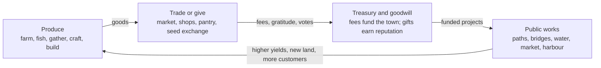
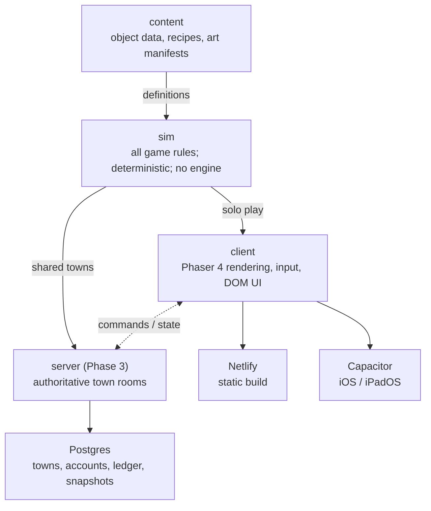
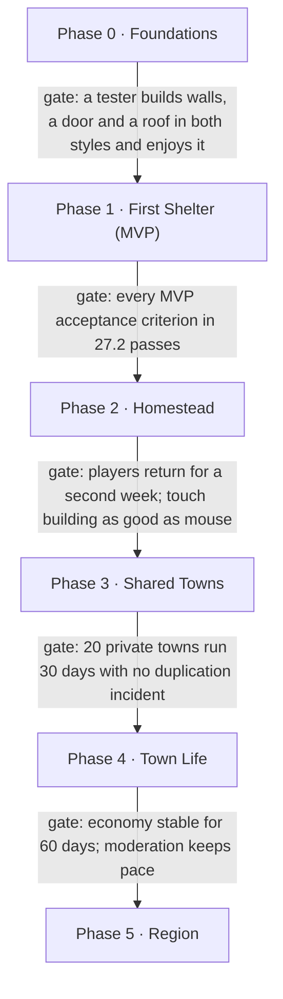

# Poor Camp: Paradise Lost — Game Design Document

Oct 25, 2026 · Justin Ward

> Exported from the living GDD (v0.1). The Claude Docs version is the working copy; this file is a snapshot for the repo.

## Document control

This is GDD v0.1, the first full draft built from the creator handoff of 2026-10-25. No game code exists yet; nothing here is final until it appears in the Decision Log (Appendix B) as **Confirmed**.

**How to read the tags.** Every rule in this document carries one of three tags.

| Tag | Meaning | Who can change it |
| --- | --- | --- |
| **\[C\] Confirmed** | Stated by the creator in the handoff. Treat as a requirement. | Creator only |
| **\[P\] Proposed** | A mechanic or solution this draft recommends. Not canon until the creator accepts it. | Creator accepts, edits or rejects |
| **\[O\] Open** | An unresolved question. Logged in section 29 with a recommendation. | Creator decides |

**Versioning.** Minor versions (v0.2, v0.3) for edits inside sections; a major version (v1.0) when the MVP scope in section 27 is signed off. Each change gets a dated line in the Decision Log.

**Canon status.** Section 4 lists what the Poor Camp project files say about Volume One's war and geography, and what still needs the creator's ruling. The Volume One manuscript itself was not in the files available to this draft, so every narrative detail there is marked for verification against the body.

**Authority order.** The creator overrides this document. Where the game and the graphic novel disagree on canon, the novel's body governs unless the creator rules otherwise.

## 1. Executive summary and game vision

*Poor Camp: Paradise Lost* is a cozy life sim where you arrive with almost nothing on the Hilo/Puna side of Hawaiʻi Island, build your own house piece by piece, grow food, and help a town abandoned by Greater America rebuild itself **\[C\]**. It ships first as a browser game at paradiselost.poor.camp, deployed on Netlify **\[C\]**.

**The one-sentence pitch.** Build a home, then a life, then a town, in a place the government gave up on.

**What makes it different from its genre neighbours.**

- **You build the house, not just decorate it \[C\].** Foundations, walls, roofs and stairs are placed one at a time. Housebuilding is the first thing you do and the thing the first release must make fun.
- **The world keeps going when you leave \[C\].** Weeds grow, shops lose customers, friendships cool. Almost all of it is recoverable.
- **Generosity is a real playstyle \[C\].** Giving food away, maintaining a park or building a neighbour's porch counts in the simulation as much as profit does.
- **You can be the villain of the town \[C\].** Reputation tracks several dimensions, and a ruthless merchant or a controversial politician is a valid character.
- **Civics are gameplay \[C\].** Long-term, towns elect governments, allocate a treasury, trade with other towns and form regional alliances.
- **Two art styles, one game \[C\].** Classic pixel art and an illustrated storybook mode share every rule and save file.

**The progression arc \[C\].** House → Homestead → Neighbourhood → Town → Intertown trade → Regional community. No player is forced past any stage.

**What the first release is.** A narrow, polished slice: a small map, salvage and gather, build a first shelter in a real construction editor, plant a garden, meet one NPC neighbour, and repair a path with them **\[C\]**. Everything else in this document is designed so that slice does not have to be rewritten later.

**The biggest risk.** Scope. The long-term vision is an MMO-adjacent civic economy; the team is a very small operation **\[C\]**. Section 27 holds the line: each phase must be shippable and fun on its own before the next one starts **\[P\]**.

## 2. Design pillars and player fantasy

Five pillars decide every trade-off. When two features compete for time, the one that serves more pillars wins **\[P\]**.

| Pillar | What it means | Test a feature must pass | Source |
| --- | --- | --- | --- |
| **1. Build it yourself** | Construction is the core verb, not a decoration layer. | Does this make building more expressive, or easier to enjoy? | \[C\] §4 |
| **2. Many ways to belong** | No classes, no single win condition. Farmer, merchant, recluse and troublemaker are all valid. | Can a player who ignores this feature still thrive? | \[C\] §3 |
| **3. A world that notices** | Absence, generosity, neglect and reputation all leave marks. Marks heal. | Does this create a visible, recoverable consequence? | \[C\] §8, §12 |
| **4. Rebuilding together** | Systems interlock: farms feed businesses, businesses fund the treasury, the treasury repairs the bridge. | Does it feed or draw from at least one other system? | \[C\] §19D |
| **5. Cozy, not toothless** | Relaxing to play, with real stakes. No raids, no arbitrary destruction of player work. | Could this make a tired player feel punished? If yes, redesign. | \[C\] §2, §8 |

**Player fantasy \[C\].** "I came here with nothing. I built that house. The bridge you crossed to get here, I helped fix. People here know my name, for better or worse."

**Emotional centre \[C\].** Hope, resilience, creativity, self-expression, relationships, and rebuilding civilisation through cooperation.

**Anti-pillars \[P\].** Things the game deliberately is not:

- Not a combat game. No soldiers to fight, no military raids.
- Not a regime-overthrow story. The war and the regime are context, not the plot.
- Not a Stardew Valley clone with a reskin. The house-first opening, the persistent world and the civic layer are the identity.
- Not a grind. Hundreds of hours should come from expression and community, not from bigger numbers.

## 3. Audience and genre positioning

The primary audience is cozy-sim players (Stardew Valley, Animal Crossing, Spiritfarer); the secondary audience is builders, tinkerers and social-sim players who want deeper systems **\[C\]**. The business goal is to reach people who would never pick up the Poor Camp card battler or detective game **\[C\]**.

**Audience segments \[P\].**

| Segment | What they want | What hooks them here | What could drive them away |
| --- | --- | --- | --- |
| Cozy core | Low stress, daily rituals, cute things, friendship | Garden, home, NPC neighbours, generosity loop | Punishing neglect, grim tone, complex UI up front |
| Builders / decorators | Creative freedom, screenshots worth sharing | Piece-by-piece house editor, two art styles, blueprints | Fiddly placement, tiny catalogue, no undo |
| Systems players | Economies, optimisation, emergent stories | Supply/demand, businesses, offline simulation | Shallow economy, obvious exploits |
| Social / civic players | Running things, community, drama | Towns, elections, LFG, reputation | Griefing, toxic politics, no safeguards |
| Poor Camp readers | The world of the novels | Setting, tone, Volume One context | Canon contradictions, lore dumps |

**Broad appeal without stereotypes \[C\].** The handoff names women who enjoy cozy games as a target. This draft does not translate that into pink menus or gendered roles **\[P\]**. It translates into the qualities this draft bets on for broad appeal (unverified; worth testing with players): self-expression, low-friction controls, relationship depth, and a world that feels safe to be in. Player avatars get full, ungendered customisation, and every activity is open to every avatar **\[P\]**.

**Positioning against neighbours \[P\].**

| Game | What we share | Where we differ |
| --- | --- | --- |
| Stardew Valley | Farming, town, relationships | You build the house; town infrastructure is player-built; optional multiplayer civics |
| Animal Crossing | Expression, real-time rhythms | Real economy, real consequences of absence, much deeper construction |
| Spiritfarer | Warmth, loss, rebuilding | Open-ended sandbox instead of a narrative arc |
| The Sims (build mode) | Piece-level architecture | A living town and economy around the house |

**Tone guard for Poor Camp readers \[P\].** The novels are a dystopia. The game keeps that world honest in the background (why the island was abandoned, what is missing) while the foreground is repair and community. A player who never reads the novels should never feel they are missing required context.

## 4. World setting and narrative boundaries

The game is set in a fictional community on the Hilo/Puna side of Hawaiʻi Island, during Volume One of *Poor Camp*, after Chinese bombing damaged the region and Greater America left its civilians to fend for themselves **\[C\]**. Volume Two and Three material is out of bounds without the creator's authorisation **\[C\]**.

### 4.1 What the project files say about Volume One

These points come from the Poor Camp project notes, not from the manuscript itself, which was not available to this draft. Each needs a check against the current body before it is used in game text **\[O\]**.

| Point | Where the notes put it | Why it matters for the game |
| --- | --- | --- |
| Greater America is at war with China through Volume One: Lake Baikal provocations, "Chinese forces expand in the South Pacific," China invades Taiwan, Japan falls at Fukuoka. | I01 ticker and radio, I01 P9, I12 RSN crawl (QA audit v662, Story Bible notes) | Supports a Pacific theatre in which Hawaiʻi could plausibly be hit. |
| The China war **ends at the Issue 12 coronation**. China becomes an ally against Russia. Stanton's line: "Let them have the Pacific. Who needs it." | I12 P0A, Stanton's China-deal speech | The game's "at war with China" condition only holds before the I12 pivot. See 4.3. |
| Hawaiʻi is a state of Greater America; it appears on its own inset on the Calloway third-term map. | Map label table (`label_map.py`) | Confirms the island is regime territory, not a separate polity. |
| AquaCorp controls water. A boardroom line orders that rainwater collection become a federal offence before the camps open. | I02/I03 boardroom (older notes; verify) | Puna households traditionally rely on rain catchment. This collides directly with the game's water systems. See 4.3. |
| Other corporate pillars: HarvestLock (agriculture), PetroVault (power), VitalEdge (medicine); consumer brands such as Quench and Plenty. | Boardroom, text-baking notes | Candidate set dressing: abandoned depots, dead meters, empty dispensaries. |
| Mandatory screens and a personalised feed reach civilians; the Eternal Leader (Emmanuel Calloway) is the public face. The Guardian has **not** taken national power in Volume One. | Canon corrections, Quickref | Any in-game broadcast must use Eternal Leader era framing, never public "Guardian" references. |
| The secret police are DOSA, the Directorate of State Assurance. | Canon corrections | Name to use if the regime's police are ever mentioned. |

**Not found in the project files:** anything about Hawaiʻi being bombed, the timing of that bombing, or the regime abandoning the island's civilians. That is not evidence it is missing from canon; it may live in the manuscript body, the Story Bible on the creator's machine (Part 27), or the creator's head **\[O\]**. The creator should say which source governs before any narrative text is written.

### 4.2 Narrative boundaries

- **No Volume Two or Three content** \[C\]: no Ashcroft coup aftermath, no Russia war, no Vol 2/3 characters, reveals or outcomes.
- **Novel characters do not appear by default** \[P\]. The cast is ordinary island residents. A cameo by any named novel character needs explicit sign-off.
- **No combat, no raids, no soldiers to fight** \[C\]. The regime is absent, not hostile.
- **Conflict comes from** scarcity, economics, relationships, local politics and competing interests \[C\].
- **Do not invent geopolitical history** \[C\]. If a line of game text explains why the island was abandoned, it must be traceable to canon or approved by the creator.

### 4.3 Canon questions that change the design

1. **When in Volume One is the game set?** \[O\] If before Issue 12, the China war is live and the island's isolation is wartime neglect. If the game's timeline crosses Issue 12, the peace (and "let them have the Pacific") could recast the abandonment as permanent. *Recommendation:* fix the game in a window before the I12 pivot and keep the war as distant background, so the game never has to depict the coronation.
2. **Is rain catchment illegal here?** \[O\] If the rainwater ban is canon in Volume One, then every catchment tank a player builds is quiet, unenforced defiance on an island the regime stopped policing. That is a strong, non-violent expression of the setting's theme. It needs the creator's ruling before the water system is designed around it.
3. **Do broadcasts still reach the island?** \[O\] A dead mandatory screen in the town square is a powerful image; a live one changes the mood. *Recommendation:* screens are mostly dark, with rare, stale broadcasts.
4. **Who are the residents?** \[O\] Long-time locals, people who stayed when others were evacuated, and possibly people the mainland would have relocated. The last group touches the novels' camp themes; it needs a ruling on whether the game references the camps at all.

### 4.4 Cultural authenticity

The setting is real land with a living Native Hawaiian culture, and the game must not treat it as a generic tropical backdrop **\[C\]**.

- **Paid cultural consultation \[P\].** The creator's Big Island contact is a valuable reader **\[C\]**. This draft also recommends budgeting for at least one paid Native Hawaiian cultural consultant with review rights over language, place, food, plants and practices. Hire them before content production, not after.
- **Fictional town, real ecology \[P\].** The community is invented, so no real family, ahupuaʻa or village is misrepresented. Geography, weather, plants and hazards follow the real Hilo/Puna region.
- **Sacred places are not resources \[P\].** Heiau, burial sites and similar places are never harvestable, buildable-over or quest loot. If they appear at all, it is with the consultant's guidance.
- **Pele and lava \[P\].** Volcanic activity is part of Puna. How the game portrays Pele, lava flows and land loss needs consultant input; the default is to treat eruptions as natural events with respect, never as a monster or a disaster minigame.
- **ʻŌlelo Hawaiʻi \[P\].** Hawaiian words appear with correct ʻokina and kahakō, only where natural, and every term is checked. No invented pseudo-Hawaiian names.
- **Local voices \[P\].** NPCs reflect the actual demographic mix of the area (Native Hawaiian, Filipino, Japanese, Portuguese, Chinese, Korean, Pacific Islander, haole and more) and its Pidgin (Hawaiʻi Creole English) where appropriate, written with consultant review rather than as accent humour.

## 5. Core gameplay loops

The game runs on three nested loops: a minute-to-minute loop of gathering and placing, a daily loop of tending and trading, and a long loop of expanding your house and your town **\[P\]**. Every system plugs into at least one of them (Pillar 4).

### 5.1 The three loops \[P\]

| Loop | Length | Steps | What the player feels |
| --- | --- | --- | --- |
| **Moment** | 1–5 minutes | Walk → salvage or gather → craft a part → place it → see the house change | Tactile progress |
| **Day** | 15–40 minutes per session | Check what changed while away → tend garden and animals → work on a build → visit, gift, trade or donate → contribute to a town project | Rhythm, care, belonging |
| **Long** | Weeks to months | Unlock materials and styles → expand or rebuild the house → specialise (or not) → town projects reshape the map → civics, trade, alliances | Ownership, legacy |

### 5.2 The opening loop (first 2–3 hours) \[C/P\]

This is the slice the first release must nail **\[C\]**.

1. Arrive at an empty, overgrown lot with a tarp and a few hand tools.
2. Salvage materials from storm- and war-damaged structures nearby.
3. Build a first shelter: foundation, floor, four walls, a door, a roof.
4. Sleep. The first night in a house you built is the game's first emotional beat.
5. Clear a patch of ground and plant a starter garden.
6. Meet the neighbour NPC, who asks for help clearing the path to the road.
7. Complete the path repair together. The map opens up.

### 5.3 How the systems feed each other \[P\]

The interconnection the handoff asks for **\[C\]** is built from a small number of shared resources, so that changing one system ripples into others without bespoke code.

| Shared resource | Produced by | Consumed by |
| --- | --- | --- |
| **Materials** (wood, stone, metal, salvage) | Gathering, salvage, crafting, trade | Housebuilding, businesses, town projects |
| **Food** | Farming, fishing, cooking | Energy, NPC needs, businesses, donations, trade |
| **Money** (working name: scrip) | Selling, businesses, wages | Buying, taxes and fees, hiring, project funding |
| **Labour** (player and NPC time) | Players, hired NPCs, volunteers | Construction, businesses, public works |
| **Goodwill** (per-NPC relationships plus reputation dimensions) | Gifts, help, reliability, donations | Favours, discounts, invitations, votes, contracts |
| **Infrastructure condition** (roads, water, bridges, market) | Town projects, maintenance | Movement speed, farm yield, commerce volume, NPC happiness |
| **Town prosperity** (a derived index) | Production, trade, population, infrastructure | NPC arrivals and departures, business demand, unlocks |

Example ripple: a player donates seeds to the seed exchange → more NPC gardens → more food in the market → lower food prices → bakery margins improve → the bakery owner pays more in market fees → the treasury funds a water line → farm yields rise.



What one player produces, sells or gives ends up, through fees and goodwill, as public works that make everyone's production easier.

### 5.4 Session design \[P\]

- A satisfying session fits in **15 minutes** on a phone and expands to two hours on a desktop.
- On return, a short **"While you were away"** card shows what changed (weeds, sales, a neighbour's gift, a stalled project) and what to do about it. One tap per item to act or dismiss.
- No daily-login streaks or penalties for skipped days beyond the natural world changes in section 18.

## 6. New-player experience and onboarding

The new player's first goal is a roof over their head, built by their own hand, within about 30 minutes of starting **\[C goal / P timing\]**. Onboarding teaches through that goal rather than through menus.

### 6.1 Arrival \[P\]

- **Character creation:** name, appearance, pronouns, art-style choice (switchable any time). Under three minutes, skippable with a randomise button.
- **Framing:** one short illustrated sequence. You arrive by boat or truck with a few belongings. The town is quiet; some houses are empty, some damaged. A neighbour points you to an overgrown lot. No exposition about the war beyond what the canon check in section 4 approves.
- **Starting kit:** tarp, hand saw, hammer, a bag of nails, a water jug, a few seed packets. No money worth mentioning.

### 6.2 The first build, step by step \[P\]

| Step | What the player does | What it teaches | Gate |
| --- | --- | --- | --- |
| 1 | Clear brush from the lot | Interaction, tool use | Lot clear |
| 2 | Salvage boards and corrugated roofing from a collapsed shed | Gathering, inventory | 20 boards, 6 roofing sheets |
| 3 | Place a post-and-pier foundation | Build mode, snapping, validation colours | Foundation valid |
| 4 | Lay floor tiles | Paint-placement, undo | Floor complete |
| 5 | Raise walls and a door | Wall tool, openings | Enclosed room |
| 6 | Roof it | Roof tool, auto-roof preview | Weatherproof check passes |
| 7 | Move in: bedroll and a crate | Furniture mode | Sleep available |

Post-and-pier is the starter foundation because it is how many real Puna houses are built on uneven lava ground **\[P; verify with local reviewer\]**.

### 6.3 Teaching principles \[P\]

- **One verb at a time.** Build mode opens with only the tools the current step needs; the rest unlock in sequence.
- **Show, then let go.** Ghost previews demonstrate a placement once. After that, hints appear only if the player stalls for 60 seconds.
- **Mistakes are free in the tutorial.** Demolition refunds 100% of materials during onboarding (later 75–100%, see section 7).
- **No fail state.** The first night arrives when the roof is done, not on a clock. A player who wanders off to explore loses nothing.
- **Every tutorial is skippable** for returning players or a second save.

### 6.4 After the first night \[P\]

The neighbour NPC introduces the garden (section 8), then the path repair (section 13). Completing the path opens the wider map, the market, and the first two or three additional NPCs. From here the game stops directing and the player chooses where to go next. A light **"Ideas" board** in the house suggests three possible next goals at any time, drawn from different playstyles, so no one path is implied as correct.

### 6.5 MVP vs future

| MVP | Future |
| --- | --- |
| Arrival, the seven-step first build, garden intro, path repair, Ideas board | Multiple origin stories; joining a friend's existing town as a new arrival (multiplayer onboarding); returning-player catch-up flow |

## 7. Housebuilding and architecture systems

The player builds their house from individual pieces on a grid, starting with a one-room shelter and growing to a multi-storey dream house; this system gets the most design and engineering attention of anything in the first release **\[C\]**.

### 7.1 Spatial model \[P\]

The build grid is the contract every other system and both art styles depend on, so it is defined once and never forked.

| Element | Lives on | Rule |
| --- | --- | --- |
| Foundation, floor, stairs, furniture, plants | **Tiles** (1 tile = 1 m × 1 m in-world) | One floor piece per tile per level |
| Walls, fences, railings, doors, windows | **Tile edges** | Walls sit between tiles, so rooms are exact and walls have no thickness to collide with |
| Columns, posts | **Tile corners** | Support upper floors and porch roofs |
| Roofs | **Roof regions** over enclosed or post-supported areas | Generated from a footprint plus a style (gable, hip, shed, flat), then hand-adjustable |
| Levels | Integer **storeys** (0 = ground) plus foundation height | Max storeys unlocked by progression |

Edge-based walls are the approach The Sims build mode uses; they make room detection, doors and windows exact and are far less fiddly than free-placed wall segments **\[P\]**.

### 7.2 Camera and build views \[O → recommendation\]

Two cameras are needed because a game view good for walking around is rarely good for drawing floor plans.

- **Play view:** isometric (2:1) with automatic wall cutaway around the player and a storey toggle. Recommended over Stardew-style top-down because multi-storey houses, roofs and interiors read far better in isometric **\[P\]**.
- **Blueprint view:** a flat, top-down floor plan in a neutral drafting style, identical in both art modes. Precise placement, measuring and copy-paste happen here **\[P\]**.
- Players can build in either view and flip with one key or button.

This is the single most consequential art and engineering decision in the project; see section 29, item D1.

### 7.3 Build tools \[C list / P detail\]

| Tool | Does | Notes |
| --- | --- | --- |
| Place | Put a piece; drag to paint floors, walls and fences | Snap to tile, edge or corner by piece type |
| Room | Drag a rectangle; walls and floor placed together | The fast path most players will use |
| Roof | Auto-roof a footprint; pick style, pitch, overhang | Manual roof pieces for advanced players |
| Move / rotate | Pick up a placed piece or a selection | Keeps contents when moving furniture groups |
| Recolour / restyle | Swap colour, finish or material in place | Material swaps charge only the difference |
| Demolish | Remove pieces | Returns 100% of materials if undone within the session; 75% after (salvage loss) |
| Undo / redo | Full history for the current build session | At least 100 steps |
| Blueprint | Save a selection or whole house as a reusable plan | Placing a blueprint lays ghost pieces; you still supply materials and labour |
| Eyedropper | Copy a piece's type and finish |  |

### 7.4 Validation \[P\]

Validation keeps houses plausible without asking players to learn engineering.

- **Placement colours:** green valid, amber valid with a warning, red invalid with a one-line reason ("needs support within 3 tiles").
- **Support rule:** anything above ground needs a supporting wall, column or foundation within a span limit set by material tier (for example 3 tiles for salvage lumber, 5 for milled lumber, 7 for steel).
- **Weatherproofing:** a room counts as a shelter when it is enclosed by walls, doors and windows and fully roofed. Shelter gates sleeping, storage and furniture comfort.
- **No impossible states:** removing a piece that holds something up asks for confirmation and shows what will collapse into salvage.
- **Collision:** the player and NPCs must be able to path to every door. The validator warns about rooms nobody can reach.

### 7.5 Rooms, comfort and purpose \[P\]

Enclosed areas are detected as rooms automatically. Furniture gives a room a purpose (bedroom, kitchen, workshop, shopfront) and a comfort score from size, light (windows), décor variety and condition. Comfort affects rest quality and, for shopfronts, customer appeal. It never blocks progress; it rewards care.

### 7.6 Materials and progression \[C goals / P numbers\]

The handoff requires earned progression and forbids an early mansion **\[C\]**. Three separate levers enforce that, so no single grind gate does all the work **\[P\]**.

| Tier | Example materials | How unlocked | Max footprint | Max storeys |
| --- | --- | --- | --- | --- |
| 1 Salvage | Reclaimed boards, corrugated sheets, tarp | Start | 24 tiles | 1 |
| 2 Rough-built | Rough lumber, cinder block, simple windows | Carpentry skill 2 + a neighbour's lesson | 60 tiles | 1 + loft |
| 3 Milled | Milled lumber, glass, metal roofing, plumbing | Town sawmill project completed | 120 tiles | 2 |
| 4 Crafted | Fine woodwork, tile, lanai screens, stonework | Skill 4 + materials trade | 200 tiles | 2 + attic |
| 5 Master | Steel frame, large glazing, custom pieces | Skill 5 + town or intertown supply chain | Plot limit | 3 |

- **Lever 1, skill:** carpentry, masonry and design skills rise by building, not by buying.
- **Lever 2, land:** larger plots come from clearing adjacent land, buying abandoned lots, or town allocation.
- **Lever 3, community:** top tiers need town infrastructure (sawmill, kiln, harbour), tying the dream house to the town's growth.

Specific local woods and stones need the cultural and ecological review in section 4.4 before they are named **\[O\]**.

### 7.7 Architectural styles \[P\]

Styles are skins over the same pieces: plantation-era cottage, single-wall plank house, raised post-and-pier, modern tropical, salvage-punk improvised, and a Hawaiʻi Regional style developed with the consultant. New styles are content drops, not code changes.

### 7.8 System specification

| Aspect | Specification |
| --- | --- |
| Player-facing experience | Build mode with Place, Room, Roof, Move, Recolour, Demolish, Blueprint; instant feedback; houses that look lived in |
| Rules and mechanics | Tile/edge/corner grid; support spans by tier; weatherproof check; room detection; comfort score |
| Inputs | Materials, tools, skill level, plot size, labour time for large jobs |
| Outputs | Shelter (sleep, storage), comfort, rooms with purposes, shopfronts, blueprints, reputation (Craftsmanship) |
| Dependencies | Gathering and crafting (materials); land and town projects (plots, tiers); economy (buying materials); rendering (both art styles) |
| Progression | Five material tiers; footprint and storey caps; style packs; blueprint library |
| Failure and recovery | No collapse during normal play; unsupported pieces cannot be placed. Neglect lowers condition (section 18); repair restores it. Demolition refunds most materials |
| Solo behaviour | Full system; NPC helpers can be hired or befriended for large builds |
| Multiplayer behaviour | Owner controls permissions: visitors can view, friends can place in marked areas, co-owners can do anything. Co-op builds pool materials and labour |
| Abuse and exploit risks | Material duplication through demolish/undo timing; building walls to trap players; offensive structures in shared towns. Mitigations in section 24 |
| MVP | Tiers 1–2, one storey plus loft, Place/Room/Roof/Move/Demolish/Undo, validation, rooms, one style per art mode, local blueprints |
| Future | Tiers 3–5, multi-storey, full style library, shared and published blueprints, custom roofs, terrain shaping, interior lighting |

## 8. Farming, gardening, and animals

Farming follows the Hilo/Puna climate (wet, warm, no frost, thin volcanic soil) rather than a four-season temperate calendar, and a player can make it their whole game without ever opening a shop **\[C\]**.

### 8.1 What makes this place different \[P; verify with local reviewer\]

| Real-world condition | Game consequence |
| --- | --- |
| Year-round growing, wetter winters (hoʻoilo) and drier summers (kau) | Two soft seasons instead of four; nothing stops growing, but what thrives shifts |
| Very high rainfall on the windward side | Watering matters less than drainage, rot and mould; catchment water is plentiful but must be stored and managed |
| Young lava ground with thin or no soil in much of Puna | Soil is built, not found: compost, mulch, raised beds and imported cinder are core early activities |
| Perennial tree crops dominate (breadfruit, banana, papaya, citrus, avocado, lychee, rambutan) | Long-horizon investments that keep producing; suits a persistent world |
| Invasive pests (little fire ant, fruit flies, slugs and semi-slugs, coffee berry borer) and feral pigs | Pest management is a real system, not a random disaster |
| Coquí frogs at night | Ambient sound, not a crop pest |

**Culturally significant crops \[O\].** Kalo (taro), ʻuala (sweet potato), ʻulu (breadfruit), ʻawa (kava) and others carry deep cultural meaning; kalo in particular is regarded as an elder sibling of the Hawaiian people. How these are grown, named and treated in the game needs the cultural consultant's direction before implementation.

### 8.2 Crop model \[P\]

| Crop type | Examples (pending review) | Time to first harvest | After harvest |
| --- | --- | --- | --- |
| Fast annuals | Leafy greens, long beans, bok choy | 3–5 in-game days | Replant |
| Slow annuals | Sweet potato, ginger, turmeric | 2–3 in-game weeks | Replant |
| Short perennials | Banana, papaya, pineapple | 3–6 in-game weeks | Regrows on a cycle |
| Trees | Breadfruit, avocado, citrus, lychee, cacao | Real-time weeks (see section 18) | Seasonal harvests for the life of the save |

Each plot tracks **soil quality** (organic matter, drainage), **moisture**, **weeds**, **pests** and **crop health**. Yield = base × soil × health × care bonus. A neglected plot never becomes unusable; it becomes weedy and less fertile, and recovers with work.

### 8.3 Making it fun rather than repetitive \[P\]

- **Investment over chores.** Early farming is hands-on; later the player builds irrigation from catchment, mulch paths, trellises, and companion plantings that remove daily chores rather than adding more plots to click.
- **Trees as legacy.** A breadfruit tree planted on day one is still feeding the town a year later. Trees are named, shown in the community legacy record, and can be planted in public spaces.
- **Variety beats volume.** The market, NPC requests and cooking reward a mix of crops, not monoculture. Selling 500 of one thing drives its price down (section 12).
- **Experiments.** Grafting, seed saving and cross-breeding produce local varieties with names the player chooses.
- **Shared harvests.** A community garden plot lets several players or NPCs contribute; harvest days are small events.

### 8.4 Animals \[P\]

| Animal | Provides | Notes |
| --- | --- | --- |
| Chickens | Eggs, pest control, fertiliser | Feral chickens are everywhere; you can befriend and coop them |
| Ducks | Eggs, slug control | Pairs with wet-ground gardens |
| Goats | Milk, brush clearing | Clear land faster; must be fenced |
| Bees | Honey, pollination bonus | Hive boxes; honey is a valuable trade good |
| Pigs | Food (optional), compost | Whether the game includes slaughter at all is an open tone question **\[O\]** |
| Fish (aquaponics, ponds) | Food, fertilised water for beds | Traditional fishponds (loko iʻa) need consultant direction |
| Dogs and cats | Companionship | Pets never die from neglect **\[C\]** |

**Neglect rule for animals \[C intent / P mechanic\].** No animal dies from player absence. A neglected animal becomes hungry and stops producing; after longer absence it wanders to a neighbour or the town animal shelter, where it is cared for and can be collected. Neighbours with permission, or a hired NPC, can feed animals while the player is away.

### 8.5 Outputs and connections

Produce goes to the player's kitchen, the market, NPC requests, the food pantry, the seed exchange, businesses (a bakery buying flour substitutes, a café buying fruit), or intertown trade. Donations count toward the Generosity reputation dimension and community legacy at full value, so giving food away is never mechanically worse than selling it (section 11).

### 8.6 System specification

| Aspect | Specification |
| --- | --- |
| Player-facing experience | Clear land, build soil, plant, tend, harvest, cook, give or sell; trees that last |
| Rules and mechanics | Per-plot soil, moisture, weeds, pests, health; crop growth curves; two soft seasons; yield formula |
| Inputs | Seeds, cuttings, water, compost, labour, tools, land |
| Outputs | Food, seeds, fibre, honey, eggs, compost, trade goods, reputation (Stewardship, Generosity) |
| Dependencies | Land and building (plots, fences, coops); water infrastructure (irrigation); economy (prices); offline simulation (growth while away) |
| Progression | Tools, irrigation, soil quality, crop unlocks via seed exchange and NPCs, grafting, larger plots |
| Failure and recovery | Weeds, pests, overripe or spoiled crops, lower soil quality. All reversible with work. Trees never die from absence |
| Solo behaviour | Full system; NPC neighbours trade seeds and buy produce |
| Multiplayer behaviour | Shared plots, co-op harvests, seed trading, permission to tend a friend's farm |
| Abuse and exploit risks | Market flooding with one crop; offline growth manipulated by changing the device clock (local saves). Mitigations in sections 12, 18, 24 |
| MVP | Clearing, compost, 6–8 crops (fast and slow annuals plus one tree), watering, weeds, chickens, local selling and giving |
| Future | Full crop list, animals, irrigation, grafting, community gardens, food processing chains, pests and seasonal events |

## 9. Crafting, gathering, and professions

There are no classes: players raise any mix of skills by doing things, can change focus at any time, and are never locked out of an activity **\[C\]**.

### 9.1 Skills instead of professions \[P\]

| Skill | Raised by | Unlocks |
| --- | --- | --- |
| Carpentry | Building with wood, furniture making | Wood tiers, furniture recipes, longer spans |
| Masonry | Stone, block, concrete work | Foundations, walls, ovens, kilns |
| Design | Decorating, varied rooms, blueprint use | Styles, colour palettes, comfort bonuses |
| Growing | Farming, gardening | Crops, grafting, soil techniques |
| Husbandry | Caring for animals | Animals, breeding, better produce |
| Fishing | Shore, reef and boat fishing | Gear, boats, fish species |
| Cooking | Preparing food | Recipes, preserved foods, catering |
| Making | Tailoring, weaving, small crafts | Clothing, textiles, decor |
| Repair | Fixing machines, salvage, utilities | Salvage yield, infrastructure repair speed |
| Trade | Buying, selling, running a business | Market insight, price tools, shop upgrades |
| Organising | Running town projects, civic roles | Larger projects, volunteer coordination |

- **Soft caps, no ceilings:** skills level quickly to 3, slowly to 5. A player can be decent at everything and excellent at a few.
- **Titles are earned, not chosen.** "Master Carpenter" appears on your profile when the skill and reputation support it; it is a description, not a class.
- **Respec is unnecessary** because nothing is ever locked off.

### 9.2 Gathering \[P\]

| Source | Yields | Renewal |
| --- | --- | --- |
| Salvage sites (damaged houses, vehicles, warehouses) | Boards, metal, fixtures, rare parts | Finite per site; new sites appear as the map opens; stops being the main source by mid-game |
| Invasive plant clearing (albizia, strawberry guava, etc.; pending review) | Wood, mulch | Regrows; clearing invasives also improves land, which turns a chore into stewardship |
| Shoreline | Driftwood, stones, shells, seaweed | Daily refresh |
| Fishing spots | Fish | Population model: overfishing lowers catch until it recovers |
| Gardens and trees | Food, fibre | See section 8 |
| Purchased or traded | Anything | Through the economy (section 12) |

Native forest and protected species are not harvestable **\[P\]**. Logging native trees would be both ecologically wrong for the setting and a cultural problem; rapid ʻōhiʻa death makes ʻōhiʻa especially sensitive.

### 9.3 Crafting \[P\]

- **Stations** (sawhorse, workbench, kiln, stove, loom, smoker) are themselves built objects placed in the house or workshop.
- **Recipes** come from skill levels, NPC teachers, salvage finds and the tool library.
- **Quality** (rough, good, fine, masterwork) depends on skill, station and input quality, and affects price, comfort and reputation (Craftsmanship).
- **Batch and queue:** crafting long jobs runs while the player does something else, including while offline (bounded by the offline rules in section 18).
- **No 40-step chains in the MVP.** Most items are one or two steps from raw material.

### 9.4 System specification

| Aspect | Specification |
| --- | --- |
| Player-facing experience | Do things, get better at them, earn a reputation for them |
| Rules and mechanics | Use-based XP per skill; recipes gated by skill, teachers and finds; quality tiers |
| Inputs | Raw materials, tools, stations, time |
| Outputs | Building parts, furniture, food, goods, tools; skill progress; Craftsmanship reputation |
| Dependencies | Every production system; economy; NPC teachers; town infrastructure for advanced stations |
| Progression | Skill 1–5 per skill, recipe unlocks, station upgrades, quality tiers |
| Failure and recovery | A failed craft returns most inputs. Depleted salvage and fishing spots recover or are replaced |
| Solo behaviour | Full; NPCs teach and trade |
| Multiplayer behaviour | Players teach each other recipes, share a workshop and tool library, fill each other's orders |
| Abuse and exploit risks | XP farming with macros; duplication via crafting cancel. Mitigations in section 24 |
| MVP | Carpentry, Growing, Cooking, Repair; workbench and stove; \~30 recipes |
| Future | All skills, quality tiers, teaching, advanced stations, long chains for specialists |

## 10. NPC simulation and relationships

NPC residents carry the solo game: they are friends, customers, workers, voters and the economy's baseline, and they keep a town alive when players are away **\[C\]**.

### 10.1 What an NPC is \[P\]

| Component | Contents | Used by |
| --- | --- | --- |
| Identity | Name, age, history, household, home | Dialogue, legacy record |
| Values | Weights on things like generosity, ambition, tradition, independence, order, fairness | Reputation interpretation, votes, opinions |
| Needs | Food, shelter, income, social contact, purpose | Requests, spending, mood, staying or leaving |
| Job | Farmer, fisher, shopkeeper, builder, teacher, unemployed, employee of a player | Production, consumption, schedule |
| Schedule | Daily routine by hour and weekday, shifted by weather and events | Where to find them, shop hours |
| Relationships | Opinion (−100 to +100) of each player and key NPCs, plus memory of notable events | Dialogue, favours, prices, gossip |
| Memory | Bounded list of notable events ("helped fix my roof", "undercut my prices") with decay | Dialogue references, opinion drift |

### 10.2 Values make reputation subjective \[C intent / P mechanic\]

The handoff asks that different NPCs read the same behaviour differently **\[C\]**. Each reputation event carries tags (for example *undercutting*: ambition +, fairness −). An NPC's opinion change = event tags × that NPC's value weights. So a hard-nosed merchant NPC admires the player who undercut a rival, while a fairness-minded fisher distrusts them. One event, two reactions, no special-case code.

### 10.3 Relationships \[P\]

- **Friendship levels:** stranger → acquaintance → friend → close friend, from conversation, gifts that match tastes, help, and shared projects.
- **Favours:** close friends lend tools, help with builds, feed animals while you are away, vote for your proposals, and offer apprenticeships.
- **Drift:** relationships slowly cool without contact **\[C\]**, but never below the level set by big shared events (a friend you rebuilt a house with stays at least an acquaintance).
- **Romance and family \[O\]:** common in the genre, not mentioned in the handoff. Recommendation: optional dating and partnership with NPCs, all orientations, no pressure, deferred past the MVP.

### 10.4 NPCs as economic and civic actors \[P\]

- They produce and consume real goods from the same economy players use (section 12). An NPC baker buys flour; an NPC family buys food.
- They take jobs at player businesses for wages.
- They vote, attend meetings and support or oppose projects according to their values and needs (section 14).
- **Population dynamics:** prosperity, housing and services draw new NPC arrivals; prolonged decline makes some leave. A floor of founding residents never leaves, so no town becomes empty **\[P\]**.

### 10.5 Requests (quests) \[P\]

Requests are generated from real NPC needs, not from a fixed list: a fisher with a broken boat asks for repair parts; a family that moved into a damaged house asks for help with walls. A small number of authored story requests per NPC give character and arcs. Requests can be completed for pay, for goodwill only, or declined without penalty.

### 10.6 Simulation level of detail \[P\]

| Level | When | Fidelity |
| --- | --- | --- |
| Full | NPC is on screen or near a player | Pathfinding, animation, conversation, live schedule |
| Light | Same town, off screen | Schedule steps, economic actions, no pathfinding |
| Summary | Town has no players online | Daily batch: production, consumption, relationship drift, events (section 18) |

This is what keeps server costs flat as towns multiply.

### 10.7 System specification

| Aspect | Specification |
| --- | --- |
| Player-facing experience | Neighbours with routines, opinions and memories who react to what you do |
| Rules and mechanics | Values × event tags → opinion; needs → requests and spending; LOD simulation |
| Inputs | Player actions, economy state, infrastructure, events |
| Outputs | Requests, trade, labour, votes, gossip, arrivals and departures |
| Dependencies | Reputation, economy, government, infrastructure, offline simulation |
| Progression | Friendship levels; unlocks of NPC teachers, helpers and stories |
| Failure and recovery | Cooled friendships and departed NPCs recover through contact and town improvement |
| Solo behaviour | Primary social layer |
| Multiplayer behaviour | Shared NPCs remember each player separately; NPCs fill jobs and roles players leave empty |
| Abuse and exploit risks | Gift spam for instant friendship (diminishing returns per day); exploiting NPC buyers as infinite sinks (finite NPC budgets) |
| MVP | 1 fully authored neighbour plus 2–3 light NPCs; schedules, friendship, requests |
| Future | 20–40 NPCs per town, values-based reactions, population dynamics, voting, romance |

## 11. Reputation, notoriety, and community legacy

Reputation is a set of independent dimensions computed from what players actually do, so a player can be a ruthless merchant and a generous neighbour at once, and can deliberately become notorious **\[C\]**.

### 11.1 Dimensions \[C list / P mechanics\]

Each dimension runs from −100 to +100, starts at 0, and moves only from logged gameplay events **\[P\]**.

| Dimension \[C\] | Rises with | Falls with |
| --- | --- | --- |
| Generosity | Donations, gifts, free labour, below-cost sales to the pantry | Hoarding public resources, taking more than you give from shared facilities |
| Reliability | Delivering contracts and promises on time, keeping shop hours | Missed contracts, abandoned commitments, bounced deals |
| Craftsmanship | Quality and variety of builds and crafted goods | Shoddy goods sold as fine, unfinished public builds |
| Stewardship | Maintaining land, public spaces, clearing invasives, sustainable fishing | Neglected property spilling onto neighbours, overfishing, littering |
| Business trustworthiness | Fair dealing, honoured prices, paid employees | Price gouging in shortages, unpaid wages, reneging on trades |
| Social relationships | Breadth and depth of friendships | Feuds, insults, broken friendships |
| Town notoriety | Visible controversy: public stunts, scandals, combative politics, pranks | Fades slowly with time and quiet |

Notoriety is **fame-or-infamy magnitude**, not a moral score. It makes people notice you; the other dimensions decide whether they like what they see.

### 11.2 Emergent labels \[C examples / P rules\]

Labels appear when combinations cross thresholds. They are descriptive and can coexist.

| Label \[C\] | Example trigger \[P\] |
| --- | --- |
| Benefactor | Generosity ≥ 60 |
| Pillar of the Community | Generosity, Reliability and Social ≥ 40 |
| Master Craftsperson | Craftsmanship ≥ 70 and a crafting skill at 5 |
| Tycoon | Top 10% of town wealth and Business trustworthiness ≥ 0 |
| Profiteer | High wealth and Business trustworthiness ≤ −40 |
| Troublemaker | Notoriety ≥ 50 and Reliability ≤ −20 |
| Recluse | Social near 0, few interactions, Stewardship ≥ 20 |

### 11.3 Consequences \[C intent / P mechanics\]

- **Subjective reactions:** reputation feeds through each NPC's values (section 10.2). A Profiteer is shunned by some NPCs and courted by others.
- **Access:** low Reliability limits public contracts; high Generosity brings invitations, gifts and help; high Craftsmanship attracts commissions.
- **Prices:** NPC shopkeepers adjust prices within ±15% based on their opinion of you.
- **Politics:** reputation shapes how NPC voters respond to a candidate (section 14).
- **No hard locks:** no reputation ever bars the player from basic survival, housing, or the market.

### 11.4 Redemption \[C\]

Every dimension decays toward 0 over time (roughly 1–2 points per in-game week) and recovers through behaviour. Big redemptive acts (rebuilding what you damaged, a large donation) move it faster. NPC memories of bad acts fade but are not erased instantly, so redemption feels earned.

### 11.5 In-world antagonism vs real harassment \[C\]

The game supports villains, not abusers. The line is drawn by **what the action targets** **\[P\]**:

| Allowed as in-world play | Not allowed (moderation, section 24) |
| --- | --- |
| Undercutting a rival shop's prices | Messages or names that harass a real person |
| Running a combative political campaign | Coordinated pile-ons, slurs, threats |
| Being unreliable on contracts you chose to take | Using game systems to block another player's access to their own home |
| Pranks with in-game, reversible effects (if added) | Offensive builds in shared spaces |
| Hoarding your own goods | Exploits, fake transactions, alt-account farming |

### 11.6 Community legacy \[C idea / P design\]

A persistent **town record** (a book in the community centre and a profile page) lists meaningful contributions: buildings raised, meals donated, bridges repaired, trees planted, offices held, projects completed. Entries are generated from logged events, cannot be bought, and stay after a player leaves the town. Each town also keeps a short **history timeline** of its milestones.

### 11.7 Anti-abuse \[C\]

- Reputation comes from gameplay events, not upvotes **\[C\]**. Player-to-player ratings, if added at all, are a small, rate-limited input, weighted by trust, and only after real interaction (a completed trade or contract).
- Self-dealing between linked accounts (same device, same payment, suspicious trade patterns) earns no reputation.
- Events are computed server-side in multiplayer, so clients cannot inject reputation.

### 11.8 System specification

| Aspect | Specification |
| --- | --- |
| Player-facing experience | A profile showing dimensions, labels and legacy; NPCs and players reacting to who you've become |
| Rules and mechanics | Tagged events → dimension deltas; decay toward 0; labels from thresholds; per-NPC interpretation |
| Inputs | Trades, donations, contracts, builds, maintenance, social actions, political actions |
| Outputs | Opinions, prices, access, invitations, votes, labels, legacy entries |
| Dependencies | Economy, NPCs, government, moderation, every action system that logs events |
| Progression | Labels and legacy accumulate; no levels |
| Failure and recovery | Bad reputation decays and can be repaired; never blocks survival |
| Solo behaviour | Reputation with NPCs only |
| Multiplayer behaviour | Visible to other players; players form their own opinions; server-authoritative |
| Abuse and exploit risks | Fake trades between alts, coordinated sabotage, rating brigades. See 11.7 and section 24 |
| MVP | Generosity and Reliability tracked with one NPC; simple legacy log |
| Future | All seven dimensions, labels, subjective NPC reactions, town record and timeline |

## 12. Economy, trading, and player businesses

The economy is a real simulation in which players and NPCs produce, consume and trade the same goods; prices respond to supply and demand, and owning a shop is a full optional playstyle that no one is required to take up **\[C\]**.

### 12.1 Goods and money \[P\]

- **Goods** are every item with a market: crops, fish, materials, furniture, meals, crafted goods. Each good has a **reference price** (its long-run value) per town.
- **Money:** a single town-level currency. Working name **scrip** **\[O\]**. What currency the abandoned island actually uses (regime dollars, local scrip, barter) is a canon question for the creator.
- **Barter** is always possible between players and with many NPCs.

### 12.2 Price model \[P\]

The local price of a good moves with how much of it the town has relative to what the town needs:

```latex
P = P_{ref} \times \mathrm{clamp}\left( \left( \frac{D}{S} \right)^{k},\ 0.5,\ 2.0 \right)
```

Here S is town stock plus recent supply, D is NPC and player demand over the last few days, and k (around 0.5) controls sensitivity. The clamp means prices can halve or double but never crash to zero or spike to absurdity. Flooding the market with one crop halves its price; a shortage doubles it.

### 12.3 Sources and sinks \[P\]

A healthy economy balances money entering and leaving, or prices inflate until money means nothing.

| Money enters (sources) | Money leaves (sinks) |
| --- | --- |
| NPC purchases (from finite NPC budgets tied to NPC incomes) | Materials and goods bought from NPC suppliers |
| Wages from NPC employers and town jobs | Business upkeep, licences, NPC staff wages |
| Town contracts paid from the treasury | Market fees and any adopted taxes |
| Intertown sales | Tool wear and repair, transport costs |
| A modest arrival grant | Land purchases, permits for large builds |

The server tracks money supply per town and nudges NPC budgets and sink rates to hold inflation near zero **\[P\]**.

### 12.4 NPCs as the economy's floor \[C intent / P mechanic\]

- **NPC suppliers** always sell basic materials, seeds and food at a premium (about 1.5× reference), so progression never stalls for lack of a player seller **\[C\]**.
- **NPC buyers** always buy staples at a discount (about 0.6× reference), so production is never worthless.
- Between those bounds, players set the market. In an active town, players out-compete NPCs; in an empty one, NPCs keep things running.

### 12.5 Casual selling \[C\]

| Channel | How it works |
| --- | --- |
| Sell bin / general store | Instant, at the NPC buy price. The no-effort option |
| Market stall (weekly market day, or a permanent stall) | Set your own prices; NPCs and players browse; unsold goods return |
| Trading board | Post offers and requests ("buying 20 boards", "selling eggs"); escrowed |
| Direct trade | Player-to-player trade window; both confirm; server-validated |
| Gift / donate | No money; feeds Generosity and the receiving NPC's opinion |

### 12.6 Full business ownership \[C list / P mechanics\]

A business is a building with a **shopfront room**, a licence, stock, prices, hours and optionally staff.

| Element | Mechanic |
| --- | --- |
| Storefront | Built in the house editor; comfort, décor and condition raise customer appeal |
| Inventory | Stocked by the owner's production, purchases, or contracts with other players |
| Prices | Owner sets each price; the panel shows the town reference price and recent sales |
| Hours | Owner sets open days and hours; NPC customers follow their schedules |
| NPC employees | Hired for a wage; tend counter, restock from storage, produce simple goods (a baker NPC bakes from flour in stock) |
| Player employees \[C: potentially\] | Contract with wage, hours and duties; wages escrowed weekly; either side can end it |
| Demand | NPC customers choose shops by price, appeal, distance, owner reputation and their own values |
| Reputation | Business trustworthiness and Reliability feed customer choice |
| Competition | Several shops of a type split demand; if margins in a category stay high for long, an NPC competitor opens, which stops permanent monopolies **\[P\]** |

**Offline operation \[C\].** NPC staff keep the shop open while the owner is away, selling from stock at the owner's prices, paid from the till. When stock or money runs out, the shop closes until restocked. Owners get a short report on return.

**Closure and recovery \[C intent / P\].** A shop with no stock or customers for a long period goes **dormant**: it stops costing upkeep and appears closed. The building, fittings and licence remain; reopening is one action plus restocking.

### 12.7 Keeping the rich from owning everything \[C intent / P mechanics\]

- Upkeep rises with the number of businesses one player owns, so a chain of ten costs more per shop than ten independents.
- Land per player in a town is capped; more needs a town allocation vote.
- Market share caps per category within a town trigger NPC competitor entry.
- Wealth has no direct political power: votes are one resident, one vote (section 14).
- Essential goods (water, basic food, basic materials) always have an NPC source, so nobody can corner survival.

### 12.8 System specification

| Aspect | Specification |
| --- | --- |
| Player-facing experience | Sell casually or run a shop; see prices move; build a commercial reputation if you want one |
| Rules and mechanics | Reference prices; supply-demand clamp; NPC floor and ceiling; escrowed trades; business upkeep, staff and offline operation |
| Inputs | Goods, money, labour, storefronts, licences |
| Outputs | Income, goods distribution, employment, fees to treasury, reputation |
| Dependencies | Every production system; NPCs; government (fees, taxes); trade and transport; offline simulation |
| Progression | Stall → shop → upgraded shop → multiple staff → intertown supplier |
| Failure and recovery | Shops go dormant rather than being lost; debt is impossible (no loans in v1) |
| Solo behaviour | NPC customers, suppliers and competitors |
| Multiplayer behaviour | Real competition, player supply chains, employment, shared markets |
| Abuse and exploit risks | Duplication, alt-account wash trading, price manipulation, bots. See section 24 |
| MVP | Sell bin, NPC general store, simple player-NPC trades, scrip, reference prices |
| Future | Market stalls, trading board, full businesses, staff, player employment, dynamic pricing at scale |

## 13. Community projects and public infrastructure

Public works are functional, not decorative: a repaired bridge joins two areas of the map, a water system raises farm yields, a marketplace increases trade, and players can contribute money, materials, labour, expertise or designs **\[C\]**.

### 13.1 The project model \[P\]

Every public work, from a footpath to a harbour, uses one structure.

| Part | Contents |
| --- | --- |
| Site | A location on the map, often a damaged structure |
| Design | A blueprint. Default designs ship with the game; players can submit their own for approval |
| Requirements | Materials list, labour hours, money, and sometimes a skill check (a Masonry 3 contributor for a stone bridge) |
| Contributions ledger | Who gave what, logged for reputation and the legacy record |
| Stages | Large projects build in visible stages (clear, foundation, structure, finish) so progress is visible and partial work is never lost |
| Effect | The functional change when complete |
| Upkeep | Condition decays; maintenance comes from the treasury, volunteers or an assigned NPC crew |

**Labour** is real work at the site: players spend time placing pieces of the public structure in a shared build mode, and NPC volunteers or paid crews add hours on their own. A stalled project keeps all completed stages **\[C intent\]**.

### 13.2 Infrastructure and its effects \[C list / P effects\]

| Infrastructure | Functional effect when built or repaired | When neglected |
| --- | --- | --- |
| Footpaths, roads | Faster movement; NPC traffic; shops along the route get more customers | Slower travel, fewer customers |
| Bridges | Connect previously separated map areas (new resources, lots, NPCs) | Weight limit, then closure; area cut off until repaired |
| Water systems (catchment, tanks, pipes) | Water access for homes, farms, businesses; enables irrigation and some recipes | Rationing, lower yields |
| Market | Weekly market day, stalls, higher NPC demand | Fewer buyers |
| Community centre | Meetings, elections, events, town record | Fewer events, lower social gain |
| Workshops, sawmill, kiln | Unlock material tiers and stations for everyone | Tier access slows |
| Parks, gardens, recreation | NPC happiness, arrivals, Stewardship gains, event venues | Overgrowth, lower happiness |
| Harbour, boat ramp | Fishing boats, intertown sea trade | Trade capacity drops |
| Utilities (solar, microgrid) | Power for machines and advanced businesses | Brownouts |
| Transport facilities | Delivery services, intertown routes | Slower, costlier deliveries |

Water ties directly to the canon question in section 4.3 about whether rain catchment is outlawed in Volume One **\[O\]**.

### 13.3 Communal facilities \[C list / P mechanics\]

These facilities make generosity mechanically real.

| Facility \[C\] | What it does |
| --- | --- |
| Community food pantry | Anyone can take staples; donors stock it. NPC families in need draw from it, raising their opinion of donors. Keeps every resident fed |
| Seed exchange | Donate seeds and cuttings; take what you need. The main route to rare and local varieties |
| Tool library | Borrow advanced tools before you can afford them; donors grow its catalogue |
| Shared workshop | Advanced stations usable by any resident |
| Public resource storage | Pooled materials for town projects |
| Community gardens | Shared plots; harvest goes to contributors and the pantry |

### 13.4 Making generosity viable \[C requirement / P design\]

The handoff forbids making giving a mechanically inferior or ruinous playstyle **\[C\]**. This draft makes it pay back in currencies money cannot buy **\[P\]**:

- **Reciprocity:** NPCs who receive help return it in labour on your builds, gifts of goods, tool loans and discounts. Tuned so a committed giver recovers roughly 70–90% of the market value of what they give, in non-monetary forms.
- **Access:** high Generosity unlocks the best tools in the tool library, rare seeds first, and invitations to cooperative ventures (a fishing co-op, a shared kiln).
- **Civic weight:** generous residents are more likely to win NPC votes and lead projects.
- **Recognition:** legacy entries, town record, titles such as Benefactor.
- **A safety net for everyone:** the pantry and tool library mean a generous player who has given everything away can still eat, build and play.

### 13.5 Who decides what gets built \[P\]

- **Solo and early towns:** projects are suggested by NPC needs and the player picks which to pursue.
- **Towns with government:** the council or residents vote on priorities and the treasury allocates (section 14).
- **Anyone can start a grassroots project** on public land with a small material deposit; it becomes official if it gets enough contributors.

### 13.6 System specification

| Aspect | Specification |
| --- | --- |
| Player-facing experience | Visible, shared construction that changes the map and the town |
| Rules and mechanics | Project = site + design + requirements + ledger + stages + effect + upkeep |
| Inputs | Money, materials, labour, skills, designs, treasury allocations |
| Outputs | Functional infrastructure, prosperity, unlocks, reputation, legacy entries |
| Dependencies | Building system, economy, NPCs, government, offline decay |
| Progression | Footpath → road → bridge → water → market → workshops → harbour → regional links |
| Failure and recovery | Neglected infrastructure degrades in stages and can always be repaired; nothing is destroyed outright |
| Solo behaviour | NPC volunteers and crews make every project completable alone, more slowly |
| Multiplayer behaviour | Pooled contributions, shared build sessions, contribution ledger |
| Abuse and exploit risks | Claiming credit for others' work (ledger prevents it); griefing builds (only approved designs place in public; removal needs a vote or owner); draining public storage (rate limits, logs) |
| MVP | One project: the path repair, with player plus NPC labour, stages and a visible map change |
| Future | Full infrastructure set, pantry, seed exchange, tool library, player designs, upkeep |

## 14. Local government, elections, and budgeting

Towns have local governments that hold a treasury and decide what public works get built, players can run for office, and hard-coded safeguards stop any official from looting, destroying or permanently sabotaging the town **\[C\]**.

### 14.1 Institutions \[C list / P mechanics\]

| Institution | Role | Default rules \[P\] |
| --- | --- | --- |
| Mayor | Proposes budgets, signs approved spending, represents the town in trade and alliances | Elected; 4-week term (real time); max 3 consecutive terms |
| Town council | Approves budgets, sets fees, approves designs for public land | 3–7 seats by population; staggered terms |
| Treasury | Public money and public material stores | Every transaction logged publicly |
| Elections | Choose mayor and council | 7-day asynchronous voting window |
| Budget proposals | Allocate treasury across categories | Proposed by mayor or any resident with enough co-signers |
| Community votes | Direct decisions (a new fee, a major project) | Any resident can call one with co-signers |
| Public records | Votes, budgets, spending, project ledgers | Read-only, always visible |

### 14.2 Governance models \[O → recommendation\]

The handoff asks whether every town uses the same structure **\[O\]**. Recommendation: towns pick from a short menu of **charters**, all sharing the same hard safeguards **\[P\]**.

| Charter | Who decides | Suits |
| --- | --- | --- |
| Mayor and council (default) | Elected officials, with community votes for big items | Most towns |
| Direct democracy | Every eligible resident votes on each budget | Small, highly engaged towns |
| Town meeting | Decisions made at scheduled meetings with a quorum | Groups that play together at set times |
| Caretaker (NPC council) | NPC council runs basics; players vote only on major items | Solo play, very small or inactive towns |

Changing charter needs a two-thirds community vote. A custom charter builder is not recommended; it multiplies edge cases and loopholes.

### 14.3 Budgets and visible effects \[C\]

The treasury allocates across categories **\[C\]**: roads, bridges, water, utilities, parks, recreation, public buildings, markets, transport, emergency reserve, community services. Each category has a maintenance cost; underfunding a category lets its infrastructure degrade on a visible schedule (section 18). Public works always need physical materials and labour as well as money **\[C\]**, so a rich treasury cannot simply buy a finished bridge.

**Revenue options \[C list; model open\].** Voluntary contributions, market fees, business taxes if adopted, publicly owned services (a town sawmill selling lumber), intertown trade revenue, donations, regional transfers. **\[O\]** The fiscal model is unfinalised. Recommendation: every town starts with voluntary contributions plus a small market fee; taxes are opt-in by community vote and capped (for example, at most 10% on business revenue) **\[P\]**.

### 14.4 Elections when activity levels differ \[C challenge / P solution\]

- **Voter eligibility:** a resident (owns or rents a home in the town) who has been active in the town at least once in the last 14 days.
- **Candidate eligibility:** resident for at least 14 days, Reliability above −20, no active moderation sanction.
- **Asynchronous windows:** voting stays open 7 days so players in every time zone and schedule can take part.
- **Quorum:** if turnout among eligible voters is under a threshold (for example 30%), the incumbent continues or the caretaker NPC council fills in; the town never locks up.
- **Absent officials:** an official inactive for 7 days triggers an automatic deputy; 14 days vacates the seat.
- **NPC voters (optional per charter):** NPCs can vote in small towns, weighted so they matter in solo or small towns but cannot override a majority of active players.

### 14.5 Safeguards \[C requirement / P rules\]

These rules are enforced by the server and no charter, official or vote can remove them **\[P\]**.

1. **Private property is untouchable** by government. No seizure, no demolition, no access without owner permission.
2. **Spending limits:** no more than 25% of the treasury in a 7-day period without a council supermajority or community vote.
3. **Emergency reserve** (10% minimum) can only be spent on declared emergencies (storm repairs) with council approval.
4. **No personal transfers:** treasury money can only go to approved projects, contracts with deliverables, or listed services. Contracts to an official or their linked accounts need an independent vote.
5. **Public works can be paused, not demolished,** by government. Removing a completed public structure needs a two-thirds community vote and a 7-day waiting period.
6. **Recall:** a petition from 25% of eligible residents triggers a recall vote.
7. **Full public ledger** of all treasury activity.
8. **The town cannot be dissolved or sold** by officials.
9. **No exile:** officials cannot remove residents. Only platform moderation can (section 24).

### 14.6 Political gameplay \[C\]

Campaign posters (built objects), town-hall debates (a scheduled event with a speaking queue), endorsements from NPCs and players, budget negotiations, coalition building on the council, and public projects as campaign promises with a visible track record. Political conflict is part of the game **\[C\]**; harassment and real-world politics in chat are moderated (section 24).

### 14.7 System specification

| Aspect | Specification |
| --- | --- |
| Player-facing experience | Run for office, vote, propose budgets, see decisions reshape the town |
| Rules and mechanics | Charters, eligibility, async elections, budgets by category, hard safeguards |
| Inputs | Votes, proposals, treasury revenue, materials, labour |
| Outputs | Funded projects, fees and taxes, maintenance levels, trade agreements, legacy entries |
| Dependencies | Economy, projects, infrastructure, reputation, NPCs, moderation, accounts |
| Progression | Town grows from caretaker council to an elected government as population and infrastructure grow |
| Failure and recovery | Bad budgets cause visible decay that is always repairable; recall and elections correct leadership |
| Solo behaviour | Caretaker NPC council; the player can run for mayor against NPCs who vote by their values |
| Multiplayer behaviour | Full elections, councils, budgets; server-authoritative and auditable |
| Abuse and exploit risks | Alt-account voting, vote buying, embezzlement, griefing via office. See 14.5 and section 24 |
| MVP | None. NPC council suggests projects; the treasury is a simple project fund |
| Future | Charters, elections, budgets, safeguards, political events |

## 15. Intertown trade and transportation

Player towns trade with each other directly, through marketplaces, and through government trade agreements; each town's economic identity emerges from its geography and its players' choices, and no inactive or hostile town can make another unplayable **\[C\]**.

### 15.1 Towns on the map \[P\]

- Each town is its own map (an instance) placed on a shared **regional map** of the Hilo/Puna area. Distance and connecting infrastructure set travel time and shipping cost.
- Starting sites differ by geography: coastal (fishing, harbour), upland (cooler crops, timber from invasive clearing), lava-field (stone, cinder, solar), river or stream-side (water, mills). Specialisation is a tendency, never a fixed class **\[C\]**.
- How far the regional map extends (Puna and Hilo only, the whole island, other islands) is open and needs canon and cultural review **\[O\]**.

### 15.2 Trading mechanisms \[C list / P mechanics\]

| Mechanism \[C\] | How it works \[P\] | Who uses it |
| --- | --- | --- |
| Direct trade | Travel to another town; trade player to player; goods move in your inventory | Players who like travel and meeting people |
| Town marketplaces | Visitors can buy from stalls and shops; towns can set visitor fees; listings can be browsed remotely and shipped | Most trade |
| Municipal trade agreements | Contract between town governments: fixed goods per week in exchange for goods or money, for a set term; escrowed from public stores | Towns with governments |
| Delivery contracts | A player or NPC carrier is paid to move goods between towns | Logistics players |

### 15.3 Transportation \[C list / P mechanics\]

| Mode | Needs | Capacity | Speed | Cost |
| --- | --- | --- | --- | --- |
| On foot / handcart | A path | Small | Slow | Free |
| Truck | Repaired road and fuel or charge | Medium | Medium | Fuel and wear |
| Boat | Harbour or ramp at both ends | Large | Medium; weather-dependent | Upkeep |
| Automated delivery (NPC service) | Any connection | Medium | Fixed delay (for example 1 in-game day) | Fee of about 10–20% of cargo value |

Players who enjoy logistics can run delivery businesses that undercut the automated service; players who do not can always pay for automation **\[C\]**.

### 15.4 Interdependence without fragility \[C requirement / P rules\]

- **Supplier failure is soft.** If a partner town misses deliveries, the contract pauses, both sides are notified, and an NPC import backstop supplies the shortfall at a premium.
- **Contracts expire.** Terms are 2–8 weeks and do not auto-renew without both governments' consent.
- **No embargo can starve a town.** Every essential good has a regional NPC source.
- **Emergency aid:** towns can send goods to a town in crisis (after a storm), recorded in both towns' histories.
- **Shocks propagate gently:** a partner's production drop raises prices in your town through the normal price model, so the effect is felt but bounded by the clamp in section 12.2.

### 15.5 System specification

| Aspect | Specification |
| --- | --- |
| Player-facing experience | Visit other towns, browse their markets, sign trade deals, run deliveries |
| Rules and mechanics | Regional map; travel time and cost by infrastructure; escrowed contracts; NPC import backstop |
| Inputs | Goods, money, transport infrastructure, government approvals |
| Outputs | Price convergence across towns, specialisation, trade revenue, relationships between towns |
| Dependencies | Economy, infrastructure, government, multiplayer backend, global ledger |
| Progression | Footpath trade → road trucks → harbour shipping → regional highway (section 16) |
| Failure and recovery | Paused contracts, NPC backstop, emergency aid |
| Solo behaviour | NPC towns on the regional map act as trading partners |
| Multiplayer behaviour | Real towns trade with each other; this is a server-side feature only |
| Abuse and exploit risks | Cross-town duplication, arbitrage bots, laundering between alt towns. All transfers go through a single server-side ledger; see section 24 |
| MVP | None |
| Future | Phase 4 (section 27) |

## 16. Regional alliances and shared projects

Regional alliances are civic and economic associations of towns, not military ones; they pool contributions for projects too large for one town while each member keeps its local autonomy **\[C\]**.

### 16.1 What alliances do \[C list\]

Regional highways, transport networks, harbour improvements, healthcare facilities, shared utilities, conservation projects, emergency relief, resource sharing, and intertown economic development.

### 16.2 Structure \[P\]

| Element | Rule |
| --- | --- |
| Membership | 2–8 towns. Joining needs a community vote in the joining town and a majority of current members |
| Regional council | One delegate per town, chosen by that town's government |
| Regional fund | Members pledge contributions (money, materials, labour hours, expertise) per project, not a standing tax |
| Regional projects | Same project model as section 13, built on a shared regional map location; contributions ledger per town |
| Shared benefits | Completed projects grant effects to members: faster travel, lower shipping costs, healthcare (NPC wellbeing), conservation bonuses (fish stocks, forest health) |
| Access for non-members | Set by the council: free, toll, or members only |
| Leaving | Any town can leave after a community vote and a 14-day notice; completed projects stay; access rules then apply |

### 16.3 Regional politics \[C\]

Disagreement is expected: which project first, who pays how much, whether non-members pay tolls. Council votes are weighted one town, one vote by default; a charter option weights by population **\[O\]**. The same hard safeguards as town government apply: no seizing a town's property, spending caps, a public ledger **\[P\]**.

### 16.4 Autonomy \[C\]

An alliance cannot set a member town's taxes, laws, charter or officials. It can only allocate the regional fund and set rules for regional assets.

### 16.5 Progression context

The full arc is House → Homestead → Neighbourhood → Town → Intertown trade → Regional community **\[C\]**. Alliances are the end of that arc, and the handoff is explicit that no one is forced to reach it **\[C\]**. For most players, alliances will be something their town is part of rather than something they personally run.

### 16.6 MVP vs future

Not in the MVP. Earliest in Phase 5 (section 27), after intertown trade has proven stable with real players. NPC towns can simulate alliance membership for solo players if testing shows players want it **\[P\]**.

## 17. Multiplayer, group invites, and LFG

Solo play is complete on its own; multiplayer is optional and central to the long-term vision, built around persistent shared towns that friends join by invitation and, later, strangers find through Looking for Group **\[C\]**.

### 17.1 Shared towns \[C list / P rules\]

| Feature \[C\] | Design \[P\] |
| --- | --- |
| Private group invitations | Owner or government sends invite links or codes; invites can be single-use or expiring |
| Personal property ownership | Each resident owns one home plot (more by purchase or allocation); ownership is server-recorded |
| Shared public infrastructure | Public land is governed by the town (section 14) |
| Cooperative construction | Several players build on the same plot or public project at once, with live updates |
| Shared town projects | Pooled contributions (section 13) |
| Asynchronous participation | Everything works when you are the only one online: contracts, projects, shops, votes |
| Permissions | Per-plot roles (below) |
| Cooperative economy | Shared supply chains, employment, co-ops |

**Town size \[P\].** Recommended cap of 12–24 player residents per town, plus NPCs. Small enough that people know each other; large enough for a functioning economy and elections. Final number set by load tests and playtests **\[O\]**.

### 17.2 Permissions \[P\]

| Role | View | Enter home | Use stations | Harvest | Place / edit | Change permissions |
| --- | --- | --- | --- | --- | --- | --- |
| Public | Exterior | No | No | No | No | No |
| Visitor (invited) | Yes | If door unlocked | No | No | No | No |
| Friend | Yes | Yes | Yes | If allowed | In marked zones | No |
| Caretaker | Yes | Yes | Yes | Yes | Repairs only | No |
| Co-owner | Yes | Yes | Yes | Yes | Yes | No |
| Owner | Yes | Yes | Yes | Yes | Yes | Yes |

The **Caretaker** role exists for the neglect system: a neighbour can water, feed and repair while you are away without being able to rebuild your house **\[C intent\]**.

### 17.3 Being together \[P\]

- **Real-time presence:** players online in the same town see each other move, build and chat. The server is authoritative; clients predict their own movement.
- **Emotes and quick phrases** for low-friction communication; text chat optional per player.
- **Shared events:** market day, harvest day, town meetings, building parties, scheduled by the town.
- **Visiting:** players can visit other public towns as guests without becoming residents.

### 17.4 Looking for Group \[C list / P design\]

A directory where towns list themselves and players find a home.

| Filter \[C\] | Shown as \[P\] |
| --- | --- |
| Playstyle | Tags: farming, building, commerce, politics, relaxed, roleplay |
| Activity level | Active residents in the last 7 days; typical online hours |
| Development stage | Settlement, village, town, regional member |
| Degree of cooperation | Co-op focus vs independent households |
| Casual vs organised | Self-declared, plus how often the town holds scheduled events |
| Town rules and governance | Charter type, town rules text, language |

Towns choose: open (anyone can join), application (residents review), or invite-only (not listed). New residents join on probation (14 days, Friend-level public permissions, cannot vote) **\[P\]**.

### 17.5 Safeguards \[C requirement\]

LFG exposes players to strangers, so it needs moderation, reporting and blocking from day one of LFG, not later **\[C\]**. Requirements in section 24. Recommendation: LFG ships only after moderation tooling and an age policy exist **\[P\]**.

### 17.6 Persistence \[C\]

Towns run whether or not anyone is online (section 18). A static Netlify site cannot host this; shared towns need a server-authoritative backend with reliable storage (sections 22–23) **\[C\]**.

### 17.7 MVP vs future

| MVP | Phase 3 | Phase 4+ |
| --- | --- | --- |
| Solo only; data model already supports multiple owners and permissions | Private invite-only shared towns, permissions, async participation, presence, chat | LFG, open towns, applications, cross-town visiting |

## 18. Offline simulation, persistence, and consequences

The world changes while players are away, because the creator does not want a world where nothing happens in their absence; those changes are visible, bounded, and almost always recoverable **\[C\]**. The in-game time system is still undecided **\[C\]**; 18.1 compares the options.

### 18.1 Time system options \[O → recommendation\]

| Option | How it works | Strengths | Problems for this game |
| --- | --- | --- | --- |
| **Real time** (Animal Crossing) | In-game clock = a real clock (town's chosen time zone) | Simple; natural for shared towns; absence maps cleanly to consequences | Slow crops feel very slow; players in other time zones always visit at night; no sleep-skip |
| **Accelerated** (Stardew Valley) | 1 in-game day = 15–20 real minutes; sleep skips the night | Brisk loops; many days per session | In shared towns, one real week away = hundreds of in-game days, so neglect explodes; sleep-skip is impossible with several players |
| **Hybrid (recommended)** | A shared accelerated **ambient clock** for day/night, weather and NPC routines; all **consequences** (growth, decay, spoilage, friendship drift) measured in real hours on saturating curves | Lively days; absence penalties stay proportionate to real absence; works identically solo and shared | Two clocks to explain; needs careful tuning and a playtest |

**Recommendation \[P\].** Hybrid, with a starting point of 1 ambient day = 48 real minutes, and consequence timers in real hours. In solo play, "rest until morning" fast-forwards the ambient clock only. This needs a prototype in Phase 1 before it is locked (section 29, item D2).

### 18.2 Neglect consequences \[C list / P curves\]

Each consequence has a start time, a cap (the worst it can get from absence alone) and a recovery path.

| Consequence \[C\] | Starts after (real time) \[P\] | Worst case from absence \[P\] | Recovery |
| --- | --- | --- | --- |
| Weeds grow | 1 day | 60% plot coverage | Clear by hand or tool; goats |
| Crops overripe or spoil | Crop-specific, 1–3 days past ripe | Spoiled crops become compost | Replant; compost improves soil |
| Pests | 3 days untended | Yield −50% | Treatment, ducks, companion planting |
| Buildings need maintenance | 7 days | Condition "worn": cosmetic wear, comfort −20%, never collapse | Repair action, materials |
| Business loses customers | 2 days closed | Shop goes dormant, no upkeep | Restock and reopen |
| Friendships weaken | 7 days no contact | Floor set by shared history | Visit, gift, help |
| Public spaces deteriorate | 7 days unfunded or unmaintained | Overgrown, closed facilities | Volunteer cleanup or budget |
| Community projects stall | 3 days no contributions | Paused; completed stages kept | Contribute |
| Town economy contracts | Sustained low activity | NPC floor holds (section 12.4) | Returning players revive it |

**Never from ordinary absence \[C\]:** losing a house permanently, a pet or animal dying, losing land you own, losing inventory or money.

### 18.3 Help while away \[C\]

- **Caretaker permission** for neighbours (section 17.2).
- **Hired NPC caretaker:** waters, feeds and does light repair for a daily wage.
- **NPCs maintain essential services** (pantry, water, basic store) so the town never stops working **\[C\]**.
- **"Away notice" \[O\]:** an optional notice that halves decay rates for up to 14 days. It softens the creator's "absence matters" rule, so it is open for the creator to accept or reject.

### 18.4 Long absence in shared towns \[P\]

A 24-resident town cannot let inactive players occupy slots forever, but the player's house can never be lost **\[C\]**.

| Inactive for | What happens |
| --- | --- |
| 30 days | Marked inactive; no vote; still owns the plot |
| 90 days | House frozen (no further decay); doesn't count toward the active cap |
| 180 days | If the town votes to reclaim the plot, the house is packed into a saved blueprint plus storage in the player's account, placeable on any plot later. Nothing is deleted |

### 18.5 How offline simulation runs \[P\]

The engine does not tick towns nobody is in. It catches up when needed.

1. **Lazy catch-up:** when a town loads (a player arrives, a contract fires), the server computes elapsed real time and applies each system's catch-up function once.
2. **Closed-form where possible:** growth, decay and drift use formulas of elapsed time (for example weeds = cap × (1 − e^(−t/τ))), not step-by-step loops.
3. **Daily batch for the economy:** NPC production, consumption, prices and cross-town contracts settle in one scheduled job per town per real day, so trade partners stay consistent even when nobody visits.
4. **Deterministic randomness:** random events use a seed of (town id, day number), so a catch-up gives the same result no matter when it runs, and replays can be audited.
5. **Event log:** every catch-up writes a short log that feeds the "While you were away" card.

This keeps idle towns nearly free to host: storage only, plus one small daily job.

### 18.6 Exploit resistance \[P\]

- **Server time only** in multiplayer; the client clock is ignored.
- **Solo local saves** can be clock-manipulated. That only affects the cheater's own game, so it is tolerated, but a local save cannot be uploaded into a shared town or affect leaderboards or legacy records.
- **Catch-up is idempotent:** reloading a town twice does not double growth or sales.

## 19. World geography, exploration, and ecology

The map is a fictional town in a real landscape: windward, rain-soaked, volcanic, with young lava, lowland forest, a black-rock coast, and Puna-style rural subdivisions on gravel roads **\[C setting / P detail\]**. The facts below come from general knowledge, not research done for this draft, and need checking with the local reviewer and consultant before content is built.

### 19.1 Biomes \[P\]

| Biome | What it looks like | Gameplay role |
| --- | --- | --- |
| Town centre | Main street, damaged shops, market square, community hall, harbour or boat ramp | Hub, projects, commerce |
| Rural subdivision lots | Gravel roads, catchment tanks, post-and-pier houses, overgrown and abandoned lots | Player homes, salvage, expansion land |
| Lowland forest | Mostly invasive trees (albizia, strawberry guava) with remnant native ʻōhiʻa | Wood from invasives, foraging, conservation projects |
| Lava fields | Pāhoehoe and ʻaʻā flows of different ages; ferns and ʻōhiʻa colonising older flows | Stone, cinder, solar sites, striking views; very slow to farm |
| Coast | Black rock shoreline, tide pools, sea cliffs, small black sand beaches | Fishing, driftwood, events, protected wildlife |
| Streams and gulches (Hilo side) | Rain-fed streams, waterfalls | Water, mills, crossings that need bridges |

### 19.2 Weather \[P\]

- Rain most days, often heavy; sunny mornings and wet afternoons are common on the windward side.
- **Gameplay:** rain waters crops, fills catchment, slows building outdoors slightly, raises mould risk in neglected buildings. Dry spells are rarer and matter more.
- **Storms \[P\]:** occasional heavy storms damage condition of buildings and infrastructure (repairable) and create community repair projects. They never destroy a player house outright **\[C intent\]**.
- **Vog** (volcanic haze) days: lower visibility, mild NPC mood dip, ambient only.

### 19.3 Volcanic and natural hazards \[O\]

Puna lives with Kīlauea. The 2018 eruption destroyed hundreds of homes in lower Puna; Hilo has a history of tsunami. Depicting these in a cozy game is sensitive for real residents. Recommendation **\[P\]**: lava and tsunami appear as **landscape and history** (old flows, a memorial, no-build hazard zones) rather than as dynamic events that destroy player work. Any dynamic eruption feature needs the consultant and creator to agree.

### 19.4 War damage \[O\]

How the Chinese bombing appears (craters, a ruined harbour, a damaged airfield, collapsed public buildings) depends on the canon ruling in section 4. Until then, damage in the MVP is generic storm and neglect damage plus a few ambiguous ruins, so nothing has to be redrawn if canon differs **\[P\]**.

### 19.5 Exploration \[P\]

- **The map opens through infrastructure, not keys:** a repaired path reaches the coast; a rebuilt bridge crosses the gulch; a cleared road reaches the next subdivision.
- **Salvage sites** reward exploring with materials and occasional story fragments (letters, photos) that show how residents lived through the war and abandonment, written within canon.
- **Points of interest:** viewpoints, tide pools, waterfalls, old flows, abandoned corporate depots (if canon allows the brands in section 4.1).
- **Fast travel** via a bus or truck route once roads are repaired.

### 19.6 Wildlife and conservation \[P\]

- Native and protected species (honu sea turtles, nēnē geese, ʻio hawks, native forest birds at higher elevation) can be observed, photographed and logged in a field journal, never caught, sold or harmed.
- The game teaches by doing: honu basking on the shore need distance; disturbing them costs Stewardship.
- Invasive species (little fire ants, coquí, feral pigs, invasive plants) are managed through conservation projects that improve land and Stewardship.
- Conservation projects (forest restoration, stream cleanup, fish stock recovery) are a full playstyle for players who want one.

### 19.7 Map scale for the MVP \[P\]

One small map: a cluster of 6–10 rural lots, the player's lot, a neighbour's house, a salvage area, a forest edge, a stream, and the damaged path out to a road. Roughly 120 × 90 tiles. Expandable to the town centre and coast in Phase 2.

## 20. Visual direction and dual-art-style architecture

The game has two switchable looks, Classic Pixel Art and Illustrated Storybook, drawn over one shared world: same geometry, object identities, construction rules, collision, interaction points, simulation and save data **\[C\]**. The way to avoid building two games is to make art a pure skin over a logic layer that never knows which style is on screen **\[P\]**.

### 20.1 The two styles \[C names / P direction\]

|  | Classic Pixel Art | Illustrated Storybook |
| --- | --- | --- |
| Feel | Crisp, readable, nostalgic | Warm, hand-painted, soft watercolour |
| Base tile (isometric 2:1) | 32 × 16 px, displayed at integer scale | Painted at 256 × 128 px, displayed scaled |
| Filtering | Nearest-neighbour, integer zoom only | Linear filtering, free zoom |
| Palette | Limited shared palette per biome | Painted; consistent through a shared colour script |
| Effects | Pixel weather, dithered shadows | Paper texture overlay, soft edge wash, painted light |
| Animation | Frame-by-frame | Fewer frames or cut-out (skeletal) animation of painted parts |

Both use the same isometric projection, so every object has the same footprint and anchor in both looks **\[P\]**.

### 20.2 Shared logic, separate skins \[P\]

Every visible thing is an **object definition** in data. Art is attached through a per-style manifest.

```
object: wall_plank_salvage
  logic: edge piece, height 1, material salvage_wood, hp 100
  footprint: edge, anchor: (0.5, 0.0)
  interaction points: none
  art:
    pixel:      atlas wall_salvage_px, frames by join-case
    storybook:  atlas wall_salvage_sb, frames by join-case
```

- The simulation, collision, save files and network messages only ever reference `wall_plank_salvage`, never an image.
- Switching style swaps texture atlases at runtime; positions, state and selection are untouched.
- A build validator (a script run on every asset change) checks that each object has art in both styles, with matching anchors and every required join-case frame.

### 20.3 How each asset type is handled \[P\]

| Asset type | Shared (logic) | Per style (art) |
| --- | --- | --- |
| Architecture pieces | Grid placement, join rules (which neighbour combinations produce which frame), cutaway rules | One frame per join case and orientation, plus a cutaway variant |
| Roofs | Roof region shape, style, pitch | Modular roof kit (slope, ridge, hip, valley, gable end) per material. MVP limits shapes to gable and shed |
| Furniture and objects | Footprint, rotation set (2 or 4 directions), interaction points | Frames per rotation and state (open, lit, damaged) |
| Terrain | Terrain-type map (grass, soil, lava, sand, water) and transitions | An autotile set per terrain per style |
| Characters | Skeleton of layers (body, clothes, hair, held tool); animation list and timing | Layer art per style; frame-by-frame (pixel) or cut-out (storybook) |
| Crops and trees | Growth stages, health states | Frames per stage and health |
| UI | Layout, behaviour, text | Two skins: pixel and painted |
| Effects | Event triggers (dust, splash, rain) | Per style particle art |

**Animation timing is shared \[P\].** A hammer swing lands on the same frame number in both styles, so gameplay timing is identical.

### 20.4 Keeping the cost under control \[P\]

Two styles roughly double art production, even with shared logic. Options:

| Approach | How | Risk |
| --- | --- | --- |
| **Lead style + follow style (recommended)** | Produce every asset first in one style; the other follows within a release; the switch only appears once both sets are complete for the content in that release | Players see the second style later |
| Derive one from the other | Paint storybook at high resolution, derive pixel versions by downscale, palette reduction and hand clean-up | Derived pixel art usually looks muddy without heavy clean-up |
| Both always in parallel | Every asset made twice at once | Highest cost; slows all content |

Which style leads is a creator decision (section 29, item D3). If AI image generation is part of the asset pipeline, test early whether it can produce **modular, tile-consistent** kits (exact anchors, matching joins across hundreds of pieces). That is a much harder ask than a single illustration, and a failed test changes the budget **\[P\]**.

### 20.5 MVP

Both styles for a small content set (one architectural style, starter furniture, 8 crops, one character base, the MVP map), with the style switch in settings. This proves the pipeline early, which is what the handoff asks for **\[C\]**.

## 21. User interface, accessibility, and controls

The game must play well with mouse and keyboard, and with touch from the first release, because iPad and iPhone are planned platforms **\[C\]**. Every action goes through one input layer that maps devices to game commands **\[P\]**.

### 21.1 Input mapping \[P\]

| Command | Mouse + keyboard | Touch | Gamepad (later) |
| --- | --- | --- | --- |
| Move | WASD or click-to-move | Tap to move; virtual stick optional | Left stick |
| Interact | E or click object | Tap object | A |
| Open build mode | B | Build button | Y |
| Place piece | Left click; drag to paint | Tap to place ghost, tap ✓ to confirm; drag to paint | A |
| Rotate | R or mouse wheel | Rotate button or two-finger twist | Bumpers |
| Cancel / back | Esc or right click | ✕ button | B |
| Undo / redo | Ctrl+Z / Ctrl+Y | Undo / redo buttons | Select / Start combos |
| Camera pan / zoom | Edge or middle-drag; wheel | One-finger drag in build mode; pinch | Right stick; triggers |
| Storey up / down | Page Up / Page Down | Storey buttons | D-pad |

**Touch build rule \[P\]:** touch placement is always two-step (position a ghost, then confirm), because fingers cover the target. This one rule removes most touch-building frustration.

### 21.2 Screen layout \[P\]

- **Play HUD:** minimal. Time and weather top-left; energy and money top-right; hotbar bottom-centre; one menu button. Notifications slide in and stack.
- **Build HUD:** tool palette left, piece catalogue bottom (searchable, filterable by category and material), properties panel right (colour, material, rotation), undo/redo and view toggle top.
- **Responsive:** layouts for phone portrait, phone landscape, tablet and desktop; minimum touch target 44 × 44 points.
- **Text:** all UI strings in localisation files from day one, even if only English ships first.

### 21.3 Accessibility \[P\]

| Area | Feature |
| --- | --- |
| Vision | UI scale 75–200%; high-contrast mode; colour-blind safe validation (shape plus colour: ✓ / ! / ✕ icons, not only green/amber/red); screen-reader labels for menus; dyslexia-friendly font option |
| Motor | Full remapping; hold-to-toggle options; no timing-critical actions in core play; click-to-move; adjustable double-tap timing |
| Hearing | Subtitles for all voiced or important audio; visual cues for sound events (doorbell, rain starting, a customer arriving) |
| Cognitive | Optional task list; pause in solo; "While you were away" summary; reduce-motion setting; no forced timers in onboarding |
| Comfort | Camera shake off by default; screen-flash limits; motion-sickness-safe camera speed |

Target: meet the basic and intermediate items of the Game Accessibility Guidelines checklist by Phase 2 **\[P\]**.

### 21.4 Audio direction \[P\]

Rain on corrugated roofs, coquí at night, wind in the forest, surf on rock. Music should be gentle and local in feel, ideally created with or reviewed by island musicians. The creator's own music production background is a possible asset here **\[O\]**.

## 22. Technical architecture and recommended stack

Recommendation: TypeScript throughout, Phaser 4 for rendering, and above all a **simulation core written as plain TypeScript with no engine dependency**, so the same rules run in the browser for solo play and on a server for shared towns **\[P\]**. Phaser with TypeScript was suggested in the handoff but is not final **\[C\]**.

### 22.1 Phaser's current state

Phaser 4.0.0 shipped on 10 April 2026 and 4.1.0 on 30 April 2026 ([Phaser 4 releases](https://phaser.io/download/phaser4)). Version 4 is a ground-up rebuild of the WebGL renderer that keeps the Phaser 3 API largely intact ([v4.0.0 announcement](https://github.com/phaserjs/phaser/discussions/7274)). It adds GPU layers for very large sprite counts and large tilemaps ([Phaser World 231](https://phaserworld.beehiiv.com/p/phaser-world-issue-231)), both relevant to big towns. Being six months old, v4 has a smaller pool of tutorials and community answers than Phaser 3; that is a real but modest risk.

### 22.2 Evaluation against the handoff's criteria \[C criteria / P assessment\]

| Criterion | Phaser 4 + TypeScript | Godot 4 (web export) | PixiJS + custom engine |
| --- | --- | --- | --- |
| Modular building | Good; custom piece sprites with depth sorting (do not rely on Tiled maps for walls) | Very good editor tooling | Everything hand-built |
| Isometric or top-down | Supported; depth sorting is your code | Strong built-in isometric tools | Hand-built |
| Large maps | Good with v4 GPU tilemap layers | Good | Good |
| Two art styles | Straightforward atlas swapping | Straightforward | Straightforward |
| Touch input | Good; DOM UI on top is easy | Good | Good |
| Persistent simulation | Neutral (sim lives outside the engine either way) | Sim in GDScript is harder to share with a Node server | Neutral |
| Future multiplayer | Excellent: same TypeScript on client and Node server | Server would be a second language or headless Godot | Same as Phaser |
| iOS/iPadOS | Wrap with Capacitor | Native iOS export is strong | Wrap with Capacitor |
| Browser load and performance | Small download, fast start | Larger web download (WebAssembly) and slower first load | Smallest |
| Netlify deploy as a ZIP | Static build, ideal | Possible; heavier | Ideal |
| Small-team fit | High, given web skills | High, if learning Godot | Low; too much to build |

**Verdict \[P\]:** Phaser 4 + TypeScript fits best, chiefly because one language spans client, server and shared simulation, and because the browser is the first platform. Godot is the credible alternative if native iOS quality ever outweighs browser-first; the engine-agnostic sim core keeps that door open.

### 22.3 Code structure \[P\]

A monorepo with four packages and one strict rule: rendering never contains game rules.

| Package | Contains | Runs on |
| --- | --- | --- |
| `sim` | All game rules: build grid and validation, farming, economy, NPCs, reputation, offline catch-up. Pure, deterministic, seeded randomness, no DOM, no Phaser | Browser and Node server |
| `content` | Object definitions, recipes, crops, NPC data, per-style art manifests; JSON with schemas and a validator | Build time and runtime |
| `client` | Phaser scenes, rendering, input layer, audio, DOM-based UI (menus, build catalogue, text) | Browser, Capacitor |
| `server` | Authoritative rooms, persistence, accounts, moderation APIs (Phase 3+) | Node |



The same `sim` package runs in the browser for solo play and on the server for shared towns; only the dashed link is added in Phase 3.

**Command pattern \[P\].** Every player action is a serialisable command (`PlacePiece{object, x, y, level, rotation}`). Solo play applies commands to the local sim; multiplayer sends them to the server, which validates and applies them to the authoritative sim, then broadcasts the result. Undo, replays, bug reports and anti-cheat all reuse the same command log.

**DOM UI over the canvas \[P\].** Menus, the build catalogue and dialogue are HTML, not canvas-drawn. That gives screen-reader support, real text input, easy localisation and responsive layouts at little cost.

### 22.4 Multiplayer layer (Phase 3) \[P\]

Colyseus is an authoritative multiplayer framework for Node.js with server-to-client state sync and matchmaking ([Colyseus on GitHub](https://www.github.com/colyseus/colyseus)), now at v0.17 with Phaser tutorials covering interpolation and client-predicted input ([Colyseus docs](https://docs.colyseus.io/tools)). Each live town becomes a room that loads the town from the database, runs the shared `sim` package, and unloads when empty. It is a strong fit for the TypeScript stack; the decision should be confirmed with a load test before Phase 3.

### 22.5 Mobile path \[P\]

Capacitor wraps a built web app in native iOS and Android shells that run it in a WebView ([Capgo guide](https://capgo.app/blog/how-to-put-a-web-app-on-the-app-store/)). Design rules from day one: touch-first input, a 60 fps budget on a mid-range iPad, texture atlases under a set memory budget (start at 256 MB of textures), saves written on every meaningful change rather than on quit (mobile apps are killed without warning), and no browser-only APIs in `sim`.

### 22.6 Performance budgets \[P\]

| Budget | Target |
| --- | --- |
| First load (MVP) | Under 15 MB, playable within 5 s on broadband |
| Frame rate | 60 fps desktop; 60 fps mid-range iPad; 30 fps floor on older phones |
| Visible objects | 3,000 sprites on screen without dropping frames |
| Save size | Under 1 MB per solo town |
| Offline catch-up | Under 200 ms for 30 days of absence |

## 23. Save-data and backend architecture

The first release saves locally in the browser; the code talks to a storage interface from day one so cloud saves and shared towns can be added without rewriting the game **\[C requirement / P design\]**. A static Netlify deployment cannot host shared towns, secure elections or a shared economy **\[C\]**.

### 23.1 Save format \[P\]

- **One versioned document per town:** `{schemaVersion, townId, createdAt, clockState, map, plots, objects, inventories, npcs, economy, reputation, projects, eventLog}`.
- **Migrations:** each schema change ships a migration function (v3 → v4), so old saves always load.
- **Compression:** JSON compressed with a standard browser codec; target under 1 MB.
- **Integrity:** a checksum detects corruption; the last three saves are kept so a bad write can be rolled back.
- **Export/import:** players can download and re-upload a solo save file (backup, moving devices).

### 23.2 Storage interface \[P\]

```
interface TownStore {
  load(townId): Town
  save(town): void          // full snapshot
  append(commands[]): void  // incremental command log
  list(): TownSummary[]
}
```

| Phase | Implementation | Where it runs |
| --- | --- | --- |
| 1 (MVP) | `LocalTownStore` on IndexedDB | Browser only; Netlify serves static files |
| 2 | `CloudTownStore`: accounts plus cloud copies of solo saves; local remains primary for play | Netlify static site + a managed Postgres database with auth (Netlify Functions or the database provider's API for light endpoints) |
| 3 | `ServerTownStore`: the server is the source of truth for shared towns | Separate Node host running the multiplayer server; Netlify keeps serving the client |

### 23.3 Server data model (Phase 3) \[P\]

| Table | Holds | Notes |
| --- | --- | --- |
| accounts | Identity, settings, age gate result, moderation status | Minimal personal data |
| towns | Charter, clock, region position, settings |  |
| residents | Account ↔ town, role, join date, activity | Drives eligibility rules |
| plots | Owner, bounds, permissions |  |
| objects | Every placed piece and item in the world | Bulk-loaded per town |
| inventories | Items held by players, NPCs, shops, public stores |  |
| ledger | Append-only record of every transfer of money or items | The anti-duplication backbone (section 24) |
| events | Reputation-tagged gameplay events | Feeds reputation, legacy, NPC memory |
| civic | Elections, ballots, budgets, proposals, records | Ballots stored separately from voter identity after counting |
| contracts | Trades, employment, delivery, municipal agreements | Escrow state |
| reports | Moderation reports and actions | Restricted access |

**Snapshots plus log \[P\]:** each town stores a daily snapshot plus the command log since. Recovery = load the snapshot, replay the log. The same mechanism enables rollbacks after an exploit is found.

### 23.4 Hosting shape and cost control \[P\]

- Netlify: the static client, as required **\[C\]**.
- Database: one managed Postgres instance serves accounts, towns and ledgers for a long time at small scale.
- Game servers: rooms load only when someone is in the town; idle towns cost storage only (section 18.5).
- Scheduled jobs: one daily economy batch per active town.
- Budget check: before Phase 3, run a load test with simulated players to get a real monthly hosting estimate per 100 active towns. No figure is given here because it depends on providers and prices this draft did not research.

### 23.5 Privacy and data obligations \[P; not legal advice\]

Accounts mean personal data. Before Phase 2, get advice on age rules (US children's privacy rules apply to under-13s), EU and UK data protection if those players are allowed, account deletion, and data export. Minnesota Lawyers for the Arts, which the creator has used before, may be a starting point. This draft is not legal advice.

## 24. Security, moderation, and anti-exploit systems

In multiplayer, the server decides everything that matters, every transfer of value goes through one append-only ledger, and moderation tools exist before strangers can meet **\[P\]**. Solo play is trusted: cheating there only affects the cheater.

### 24.1 Principles \[P\]

1. **Server authority.** Clients send commands; the server validates against the authoritative sim and rejects anything impossible (placing a piece you don't own the materials for, moving faster than allowed).
2. **Conservation of value.** Money and items are never created or destroyed except by listed sources and sinks. Every transfer is a ledger entry with a matching debit and credit.
3. **Escrow for exchanges.** Trades, contracts and wages lock goods in escrow until both sides' conditions are met.
4. **Idempotent commands.** Each command carries a unique id; replays of the same id do nothing. This closes most duplication bugs caused by lag or reconnects.
5. **Everything is logged** and replayable from snapshot plus log (section 23.3), so exploits can be rolled back precisely.

### 24.2 Exploits and mitigations

| Threat | Mitigation \[P\] |
| --- | --- |
| Item or money duplication | Ledger conservation checks; idempotent command ids; nightly reconciliation job flags any imbalance |
| Demolish/undo material farming | Undo history is per session and server-held; refunds tracked per piece |
| Alt-account wash trading (fake reputation, money laundering) | Device and account linkage signals; trades between linked accounts earn no reputation; anomaly detection on circular trades |
| Market manipulation (cornering, price spikes) | Price clamp; NPC supply ceiling; per-player daily listing limits; market share caps triggering NPC competitors |
| Bots and macros | Rate limits per command type; diminishing returns on repetitive actions; behavioural flags reviewed by humans; no real-money trading |
| Vote manipulation | One resident, one vote; residency and activity eligibility; probation for new residents; anomaly detection on sudden resident influx before votes |
| Embezzlement by officials | Hard safeguards in section 14.5 |
| Griefing builds (walls trapping players, offensive structures) | No building on others' plots without permission; public land only via approved designs; pathing validator; report-and-hide for offensive builds |
| Draining shared facilities | Per-player daily take limits on pantry, tool library, public storage; logs visible to the town |
| Client tampering | Server ignores client state; only commands are trusted, and only after validation |
| Account takeover | Email verification, optional two-factor, rate-limited login |

### 24.3 Moderation \[C requirement / P design\]

Required before LFG or open towns launch **\[C\]**.

| Tool | Purpose |
| --- | --- |
| Block | Hides a player's chat, messages and presence from you; they cannot trade with you or enter your plot |
| Mute | Hides chat only |
| Report | Player, message, build, sign, town listing or name; captures context automatically (recent chat, a screenshot of the build) |
| Text filter | Names, chat, signs and listings; strong default, cannot be turned off for players under 18 |
| Town moderators | Town government can appoint moderators who can mute in public chat and hide offensive builds on public land, all logged |
| Platform moderation | The developer's own review queue with warnings, suspensions and bans; appeals by email |
| Rules of conduct | Short, plain-language rules shown at multiplayer sign-up; distinguish in-character villainy from real harassment (section 11.5) |

**Age policy \[O\].** Recommendation: multiplayer chat requires a 13+ age gate; under-13s get solo play and emote-only interaction in invite-only towns, or no multiplayer at all. Legal advice is needed before deciding (section 23.5).

**Staffing reality \[P\].** A very small team cannot moderate an open MMO. That is the main reason this plan keeps towns invite-only through Phase 3 and caps town sizes, and why LFG waits until reporting volumes from invite-only play are known.

## 25. Progression, retention, and long-term replayability

Hundreds of hours should come from expression, relationships and a changing town, not from grinding bigger numbers; progression is broad (many things to unlock) rather than tall (one number to raise) **\[C goal / P approach\]**.

### 25.1 Progression tracks \[P\]

| Track | Measured by | Long-term ceiling |
| --- | --- | --- |
| Home | Material tier, footprint, storeys, styles, comfort | A dream house; then more houses, gardens, businesses |
| Land | Plot size, cleared and restored land | Plot cap; then land in other towns |
| Skills | Eleven skills, 1–5 each | Mastery titles; teaching others |
| Relationships | Friendship levels with NPCs and players | Close bonds, stories, partnership |
| Collection | Field journal (species), recipe book, crop varieties, furniture catalogue | Completion for collectors |
| Town | Infrastructure built, prosperity, population | A thriving town; then trade and alliances |
| Legacy | Town record entries | Unbounded |

### 25.2 Avoiding grind \[C challenge / P solutions\]

- **Each tier is a new thing to do, not the same thing with bigger numbers.** Tier 3 adds plumbing and glazing as building mechanics, not just higher-HP walls.
- **Automation replaces chores as you progress.** Irrigation, NPC helpers, crafting queues.
- **Diminishing returns** on repeating the same action in a day push variety.
- **Gates tied to community** (sawmill, harbour) spread progress across social play.
- **No energy wall that ends a session early.** Energy limits strenuous actions per in-game day but always leaves something to do (decorate, visit, plan).

### 25.3 Scarcity without stress \[C challenge / P solutions\]

- Scarcity is **local and temporary**: a material is short this week, not forever; NPC suppliers cap how bad it gets.
- The **pantry and tool library** guarantee nobody is stuck.
- Shortages create **opportunities** (a player who imports glass during a shortage earns well) rather than dead ends.

### 25.4 Long-term hooks \[P\]

| Hook | Example |
| --- | --- |
| Calendar events | Harvest festival, market fairs, a town anniversary; designed with the cultural consultant, never appropriating sacred observances |
| Seasonal content drops | New architectural styles, crops, furniture sets, NPCs |
| Town milestones | Unlock celebrations, new map areas, a history entry |
| Creative sharing | Blueprint library, photo mode, house tours |
| Social play | Co-op builds, elections, trade networks |
| New starts | A second save, a new town, a different playstyle |

### 25.5 Casual and engaged players together \[C challenge / P solutions\]

- **Contribution, not competition, by default.** A casual player's 20 minutes of watering the community garden counts in the ledger alongside an engaged player's bridge.
- **No public wealth leaderboards** by default; legacy and contribution are the visible measures.
- **Async everything:** votes, projects, trades and shops work across schedules.
- **Catch-up for returners:** the "While you were away" card and short, recoverable neglect.
- **Engaged players get depth, not dominance:** businesses, politics, logistics and master crafting, all bounded by the anti-domination rules in section 12.7.

### 25.6 Solo and multiplayer balance \[C challenge / P solution\]

Every system works solo through NPCs; multiplayer adds people, not exclusive power. No item, style or progression track is multiplayer-only, except things that are inherently social (elections against real candidates, intertown trade with real towns).

## 26. Monetization considerations and player trust

The handoff rules out pay-to-win and permanently inaccessible essential resources **\[C\]**; it does not set a business model, so everything below is a recommendation for the creator to decide **\[O\]**.

### 26.1 Recommended model \[P\]

| Phase | Model | Why |
| --- | --- | --- |
| MVP and early access | Free to play in the browser | Reach, feedback and a playtest community via poor.camp and its forum |
| Full solo game | One-time purchase (browser and later App Store), with the MVP slice staying free as a demo | Clear value; cozy-sim audiences are used to buying games outright |
| Shared persistent towns | Optional **town hosting** subscription paid by one person per town; visitors and residents play free | Server costs are real and ongoing; one payer per town keeps it cheap for friends |
| Cosmetics | Optional architectural style packs and furniture sets, also earnable or craftable in-game over time | Funds content drops without touching progression |
| Support | Supporter tier or patronage through poor.camp with recognition, not power | Fans of the series can back it |

### 26.2 Never \[P\]

- Selling resources, scrip, materials, land or reputation.
- Paid time skips or paid neglect protection. These would turn the world-responds-to-absence design into a paywall.
- Loot boxes or randomised paid rewards.
- Ads inside the game world.
- Energy refills or any mechanic that ends a session unless you pay.
- Multiplayer advantages for payers beyond hosting a town.

### 26.3 Trust commitments \[P\]

- Publish a short plain-language pricing and data page before Phase 2.
- If the multiplayer service ever shuts down, players can export their town as a solo save. This addresses a major fear about persistent online games.
- If AI-generated art or text is used in the shipped game, disclose it clearly; some stores and audiences expect this, and the cozy audience includes many artists **\[P\]**.

## 27. MVP and phased development roadmap

Development runs in six phases, each ending in something playable and each gated by acceptance criteria; the first release is Phase 1, a polished housebuilding slice, and the multiplayer economy, government and alliances come only after it proves fun **\[C scope / P phasing\]**. No calendar dates are given: for a very small team they would be guesses, and the gates matter more than the dates.

### 27.1 Phases \[P\]



Phase 1 is the first public release; the table below gives each phase's full contents.

| Phase | Name | Contents | Gate to leave the phase |
| --- | --- | --- | --- |
| 0 | Foundations | Repo, sim/client split, command pattern, grid and wall placement spike in both art styles, time-system prototype, decisions D1–D3 | A tester places walls, a door and a roof in both styles and calls it pleasant |
| 1 | First Shelter (MVP) | The 12 handoff items **\[C\]**: small map, movement, salvage, piece-by-piece shelter, construction editor, unlocks, local save, garden, one NPC, path repair, both art modes, Netlify build | MVP acceptance criteria below |
| 2 | Homestead | Town centre and coast, 8–12 NPCs, deeper farming and animals, crafting stations, market stall, comfort and rooms, tier 3 materials, accounts and cloud saves, iPad beta via Capacitor | Players return for a second week unprompted; touch building rated as good as mouse |
| 3 | Shared Towns | Invite-only multiplayer, permissions and caretakers, presence, chat, moderation basics, server-side sim and ledger | 20 private towns run 30 days with no duplication incident and manageable reports |
| 4 | Town Life | Businesses and employment, reputation dimensions, community facilities, government and elections, LFG, intertown trade | Economy stable (inflation near zero) across all live towns for 60 days; moderation keeps pace |
| 5 | Region | Regional map, alliances, regional projects, NPC towns for solo players | Alliances form without breaking member towns |

### 27.2 MVP acceptance criteria \[P\]

The MVP ships when every item below is true.

- [ ] A first-time player builds an enclosed, roofed shelter in under 40 minutes without outside help (tested with at least 5 people who have not seen the game).
- [ ] Placement, rotation, undo and demolish work with mouse, keyboard and touch; no stuck states in 30 minutes of free building.
- [ ] Validation never allows an unsupported piece and always explains a rejection in one line.
- [ ] At least 40 placeable pieces across foundations, floors, walls, doors, windows, roofs, stairs and furniture, all with art in both styles.
- [ ] Switching art style mid-build changes nothing except appearance; tested by saving in one style and loading in the other.
- [ ] 6–8 crops grow, can be neglected (weeds, overripe) and recovered.
- [ ] One neighbour NPC with a schedule, friendship levels and the path-repair request.
- [ ] Path repair is a multi-stage community project completed with NPC labour, opening a new area.
- [ ] Tier 1 → tier 2 unlock works through skill and the neighbour's lesson.
- [ ] Local save survives browser restart; save migration from at least one earlier schema version is tested.
- [ ] Returning after 3 real days shows a correct "While you were away" summary with recoverable consequences.
- [ ] Built as static files, deployed to paradiselost.poor.camp on Netlify, loads in under 5 seconds on broadband, runs at 60 fps on a mid-range iPad in Safari.
- [ ] No game rule lives in the `client` package (code review check).

### 27.3 What the MVP deliberately leaves out \[C/P\]

Multiplayer, accounts, businesses, government, elections, intertown trade, alliances, animals beyond chickens, tiers 3–5, multiple storeys beyond a loft **\[C: do not attempt the full economy, government and alliance system in the first release\]**. The data model and code structure still assume all of them (multiple owners per town, a ledger-shaped inventory, command logs), so none require a rewrite later **\[C\]**.

## 28. Technical risks, scope risks, and mitigation

The largest risk is scope: the long-term vision is the size of a studio MMO and the team is very small, so the plan's main defence is that every phase must stand alone as a good game **\[P\]**.

| # | Risk | Likelihood | Impact | Mitigation \[P\] |
| --- | --- | --- | --- | --- |
| R1 | Scope outruns the team; the game never ships | High | Severe | Phase gates; MVP limited to the 12 handoff items; later phases are optional extensions, not promises |
| R2 | Building feels fiddly, especially on touch | Medium | Severe (it is the core) | Phase 0 spike in both styles; two-step touch placement; Room tool; playtest every week of Phase 1 |
| R3 | Two art styles double the art workload | High | High | Lead-and-follow production; shared logic layer; asset validator; small MVP content set |
| R4 | Modular art can't be produced consistently (by hand or by AI generation) | Medium | High | Pilot a 20-piece kit in both styles before committing; budget for an artist if the pilot fails |
| R5 | Isometric depth sorting and wall cutaways become a bug farm | Medium | Medium | Edge-based walls; one sorting function owned by the sim grid; visual regression screenshots |
| R6 | Offline neglect feels punishing | Medium | High | Caps and floors per consequence; caretakers; playtest returning after 3, 7 and 30 days |
| R7 | Economy inflates or collapses | Medium | High | Source/sink tracking; price clamp; NPC floor; simulate a year of economy offline before Phase 4 |
| R8 | Server costs exceed revenue | Medium | High | Lazy catch-up; rooms only for occupied towns; hosting subscription; load test before Phase 3 |
| R9 | Griefing and harassment in shared towns | High (once LFG opens) | Severe | Invite-only until Phase 4; moderation tooling first; caps on town size; age policy |
| R10 | Cultural misrepresentation of Hawaiʻi | Medium | Severe | Paid consultant with review rights before content production; fictional town; sacred sites off-limits |
| R11 | Canon contradiction with the novels | Medium | Medium | Section 4 verification list; creator sign-off on all narrative text; no Vol 2/3 content |
| R12 | Phaser 4 is young; fewer answers when stuck | Low–medium | Medium | Engine-agnostic sim; pin versions; contribute fixes upstream if needed |
| R13 | Browser save loss (cleared storage, private mode) | Medium | Medium | Persistent-storage request, export/import, cloud saves in Phase 2 |
| R14 | Legal and privacy obligations once accounts exist | Medium | High | Advice before Phase 2; minimal data; age gate |

Likelihood and impact ratings are this draft's judgement, not measured.

## 29. Unresolved design decisions

Twenty-three decisions are open; three of them (D1–D3) block Phase 0 and should be settled first. Each has a recommendation the creator can accept with one change of the status column.

### 29.1 Decisions that block Phase 0

| ID | Question | Recommendation | Blocks | Status |
| --- | --- | --- | --- | --- |
| D1 | Camera and projection: isometric or top-down? | Isometric 2:1 play view plus a flat blueprint view (section 7.2) | All art, building code | Decided 2026-10-25: isometric |
| D2 | Time system: real, accelerated or hybrid? | Hybrid: accelerated ambient clock, real-hour consequences; prototype first (section 18.1) | Farming, neglect, NPC schedules | Open |
| D3 | Which art style leads production? | Whichever the creator can produce consistently at modular-kit scale; pilot both with 20 pieces (section 20.4) | Art pipeline, MVP content | Open |

### 29.2 Canon questions (creator rulings needed)

| ID | Question | Recommendation | Blocks | Status |
| --- | --- | --- | --- | --- |
| K1 | Which source holds the Hawaiʻi bombing and abandonment canon (body, Story Bible 27, the creator)? | Creator names the source; game text cites it | Any narrative text | Open |
| K2 | When in Volume One is the game set relative to the I12 China peace? | Before the I12 pivot, war as distant background (section 4.3) | Story framing, broadcasts | Open |
| K3 | Is rain catchment illegal in Volume One, and does it apply here? | If yes, use catchment as quiet, unenforced defiance | Water system design | Open |
| K4 | Do broadcasts and mandatory screens still reach the island? | Mostly dark, rare stale broadcasts | Town atmosphere | Open |
| K5 | Who are the residents; does the game reference the camps at all? | Locals and those who stayed; camps unmentioned unless the creator wants it | NPC writing | Open |
| K6 | What currency does the island use? | Local scrip, with regime dollars as a dead currency | Economy UI | Open |
| K7 | Can regime corporate brands (AquaCorp, HarvestLock, PetroVault, VitalEdge) appear as abandoned set dressing? | Yes, as ruins and dead meters only | Art, salvage sites | Open |
| K8 | How far does the regional map extend (Puna/Hilo, island, other islands)? | Hilo/Puna region only until canon and cultural review | Phase 4–5 | Open |

### 29.3 Design and business questions

| ID | Question | Recommendation | Blocks | Status |
| --- | --- | --- | --- | --- |
| G1 | Do towns choose governance models? | A short menu of charters with shared safeguards (section 14.2) | Phase 4 | Open |
| G2 | Fiscal model | Voluntary contributions plus a small market fee; capped taxes by vote | Phase 4 | Open |
| G3 | Regional council voting weight | One town, one vote; population weighting as an option | Phase 5 | Open |
| G4 | Optional "away notice" that halves decay | Creator's call; it softens the absence rule | Section 18 tuning | Open |
| G5 | Town size cap | 12–24 player residents, set by load tests | Phase 3 | Open |
| G6 | Romance and partnership with NPCs | Optional, all orientations, after MVP | NPC writing | Open |
| G7 | Livestock slaughter | Leave out of MVP; decide tone later | Animals | Open |
| G8 | NPC voters in small towns | Yes, weighted so they can't override active players | Phase 4 | Open |
| G9 | Business model | Free MVP; one-time purchase; optional town hosting subscription; cosmetics (section 26) | Phase 2 | Open |
| G10 | Age policy for multiplayer | 13+ for chat; legal advice first | Phase 3 | Open |
| G11 | AI-generated assets and disclosure | Pilot first; disclose if shipped | Art pipeline | Open |
| G12 | Music and sound | Original score, possibly by the creator, with island musicians' input | Phase 2 | Open |

## 30. Concrete next steps for implementation

The next step is not code: it is three decisions (D1–D3), the canon source for the island's history (K1), and a small art pilot, after which the first sprint in Appendix A can start **\[P\]**.

1. **Creator review of this GDD.** Mark each \[P\] item accepted, edited or rejected; set the status column in section 29.
2. **Decide D1–D3** (projection, time system, lead art style). Everything in Phase 0 depends on them.
3. **Rule on K1–K3** (canon source, timing within Volume One, rain catchment). These shape the water system and all narrative text.
4. **Art pilot.** Produce a 20-piece starter kit (foundation, floor, four wall join cases, door, window, two roof pieces, bedroll, crate, two terrain tiles, one character base) in both styles to the anchor and tile spec in section 20. This tests whether the planned production method works at modular scale before money and months are committed.
5. **Contact the cultural consultant and the Big Island reader.** Share sections 4.4, 8.1 and 19 for an early sanity check; agree on a paid review arrangement.
6. **Set up the repository.** A separate repository for the game (not the Poor Camp novel toolchain), monorepo layout from section 22.3, TypeScript, Phaser 4, a CI build that produces the Netlify-ready static folder.
7. **Run Sprint 1** (Appendix A).
8. **Weekly playtests from Sprint 2 onward,** even with two or three people, focused on building feel.

## Appendix A. First development sprint

**Sprint goal:** on a small empty lot, a player can lay a floor, raise walls with a door, put a roof on, undo mistakes, switch art style, and reload the page to find the house still there **\[P\]**. Sized as roughly two weeks of one developer's time; that is an estimate, not a commitment.

This sprint builds the real foundation, not a throwaway: the `sim` package, command pattern and grid written here are the ones the finished game uses.

### A.1 Backlog

| # | Story | Package | Done when |
| --- | --- | --- | --- |
| 1 | Monorepo with `sim`, `content`, `client`; TypeScript strict; lint; unit test runner; one-command build to a static folder | all | `build` produces a folder that runs when dropped onto Netlify |
| 2 | Build grid: tiles, edges, corners, one storey; serialisable state | sim | Unit tests for placing and removing on all three slot types |
| 3 | Command pattern: `PlacePiece`, `RemovePiece`, `Undo`, `Redo`; command log | sim | 100-step undo/redo round-trips to identical state in tests |
| 4 | Validation: floor needs foundation, wall needs floor, roof needs enclosed walls; one-line rejection reasons | sim | Tests cover every rejection reason |
| 5 | Room detection and weatherproof check | sim | A four-wall, door, roof room reports "shelter"; removing a wall clears it |
| 6 | Content definitions for \~12 starter pieces with per-style art manifest; content validator | content | Validator fails the build if any piece lacks art or anchors in either style |
| 7 | Isometric renderer with depth sorting and wall cutaway around the cursor | client | No sorting glitches in a scripted 10-room test house |
| 8 | Build mode UI: catalogue, place, drag-paint, rotate, demolish, undo/redo; green/amber/red ghosts with icons | client | A tester builds a room with mouse only, then touch only |
| 9 | Two-step touch placement | client | Tested on an iPad in Safari |
| 10 | Style switch with placeholder art in both styles (flat-shaded pixel set and painted-look set) | client | Switching mid-build changes appearance only |
| 11 | `LocalTownStore` on IndexedDB; save on every committed command; schema version 1 | client + sim | Reload restores the exact house; corrupted save falls back to the previous one |
| 12 | Time-system prototype: ambient clock plus one real-hour consequence (weeds on a test plot) | sim | Catch-up after a faked 3-day gap gives the same result twice (determinism) |

### A.2 Out of scope for Sprint 1

Character movement, gathering, farming, NPCs, final art, audio, onboarding. They begin in Sprint 2 on top of this foundation.

### A.3 Sprint review

- [ ] Three people who have not seen it build a roofed room; note every hesitation.
- [ ] Decide whether the camera choice (D1) holds up in practice.
- [ ] Record findings in the Decision Log and adjust Sprint 2.

## Appendix B. Decision log and highest-impact decisions

### B.1 Highest-impact decisions before implementation

Ranked by how much work a wrong or late answer would throw away.

1. **D1, camera and projection.** Every art asset and the whole building system depend on it. Changing it after Phase 1 means redrawing everything.
2. **D3 plus the art pilot, lead style and production method.** Decides whether two art styles are affordable at all. A failed pilot changes the budget, not just the schedule.
3. **K1 and K2, canon source and timing within Volume One.** Decide the opening framing, every NPC's backstory and whether the China war is live. Cheap to settle now; expensive to rewrite later.
4. **D2, time system.** Shapes farming pace, neglect, NPC schedules and how solo and shared towns relate.
5. **K3, rain catchment.** Decides whether the water system carries the setting's theme or is neutral plumbing.

### B.2 Decision log

Newest first. One line per decision; detail lives in the section cited.

| Date | Decision | Status | Section |
| --- | --- | --- | --- |
| 2026-10-25 | D1: isometric 2:1 camera | Confirmed (creator) | 7.2, 29 |
| 2026-10-25 | GDD v0.1 drafted from the creator handoff | Draft | All |
| 2026-10-25 | Browser first, deployed on Netlify at paradiselost.poor.camp; iOS/iPadOS later | Confirmed (handoff) | 1, 22 |
| 2026-10-25 | Set during Volume One only; no Vol 2/3 content without authorisation | Confirmed (handoff) | 4 |
| 2026-10-25 | No combat, raids or repeated destruction of player work | Confirmed (handoff) | 2, 4 |
| 2026-10-25 | No classes; any mix of activities; priorities can change | Confirmed (handoff) | 3, 9 |
| 2026-10-25 | First major task is building your own house piece by piece; progression earned; no early mansion | Confirmed (handoff) | 6, 7 |
| 2026-10-25 | Farming reflects Hawaiʻi Island conditions; farming viable without a shop | Confirmed (handoff) | 8 |
| 2026-10-25 | Public infrastructure is functional | Confirmed (handoff) | 13 |
| 2026-10-25 | Complete solo game; multiplayer optional; persistent shared towns need a backend | Confirmed (handoff) | 17, 23 |
| 2026-10-25 | Player absence has consequences, generally recoverable; no house loss or pet death | Confirmed (handoff) | 18 |
| 2026-10-25 | Real economy; NPCs prevent collapse; no pay-to-win | Confirmed (handoff) | 12, 26 |
| 2026-10-25 | Shops optional; casual selling distinct from ownership | Confirmed (handoff) | 12 |
| 2026-10-25 | Generosity mechanically viable; communal facilities functional | Confirmed (handoff) | 13 |
| 2026-10-25 | Good and bad reputations allowed; multi-dimensional; redeemable; not upvote-driven | Confirmed (handoff) | 11 |
| 2026-10-25 | Local government with treasury, elections and safeguards | Confirmed (handoff) | 14 |
| 2026-10-25 | Intertown trade; regional civic alliances | Confirmed (handoff) | 15, 16 |
| 2026-10-25 | Two selectable art styles sharing all logic and saves | Confirmed (handoff) | 20 |
| 2026-10-25 | Time system undecided; Phaser + TypeScript suggested, not final | Open (handoff) | 18, 22 |

### B.3 Sources

Looked up for this draft, as of 2026-10-25:

- [Phaser 4 releases](https://phaser.io/download/phaser4)
- [Phaser v4.0.0 announcement](https://github.com/phaserjs/phaser/discussions/7274)
- [Phaser World issue 231](https://phaserworld.beehiiv.com/p/phaser-world-issue-231)
- [Colyseus on GitHub](https://www.github.com/colyseus/colyseus)
- [Colyseus documentation](https://docs.colyseus.io/tools)
- [Capgo: putting a web app on the App Store with Capacitor](https://capgo.app/blog/how-to-put-a-web-app-on-the-app-store/)

Poor Camp canon points in section 4 come from the Poor Camp project notes (QA audit v662, Story Bible notes, canon corrections, map label table), not the manuscript body. Hawaiʻi geography, ecology and culture in sections 4.4, 8 and 19 come from general knowledge and are flagged for local and cultural review.
